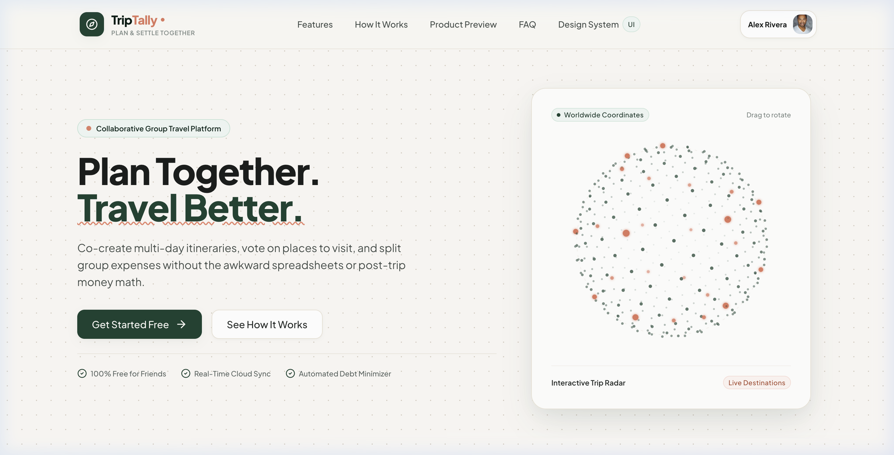
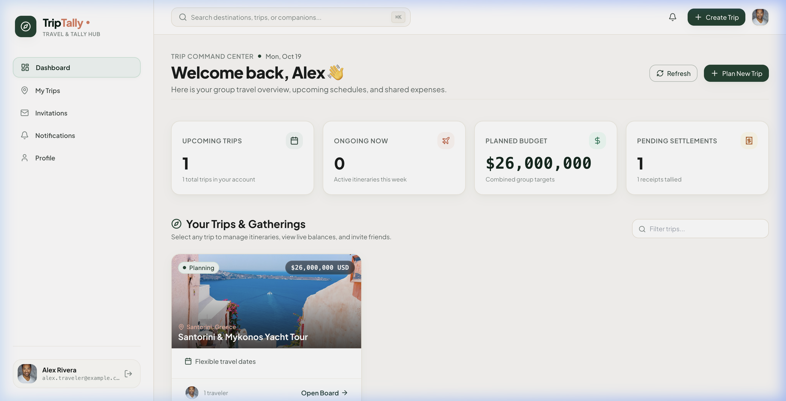
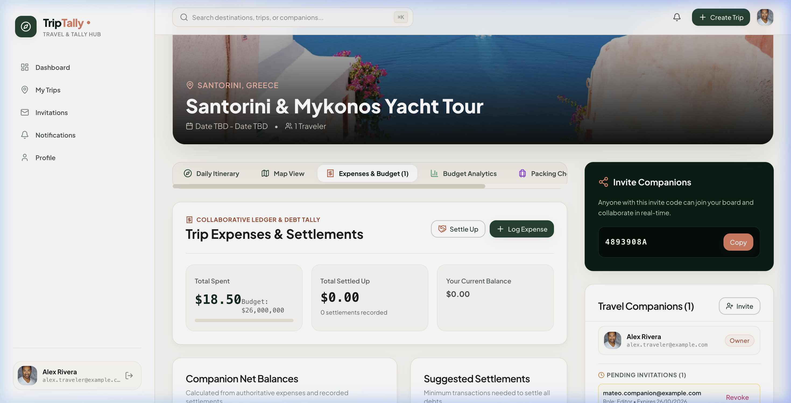
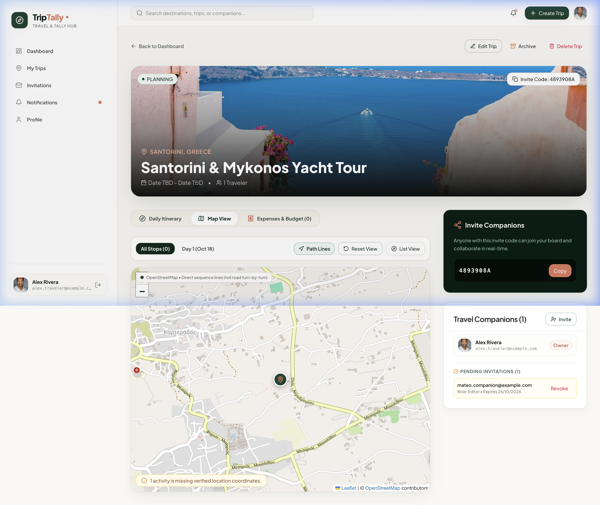
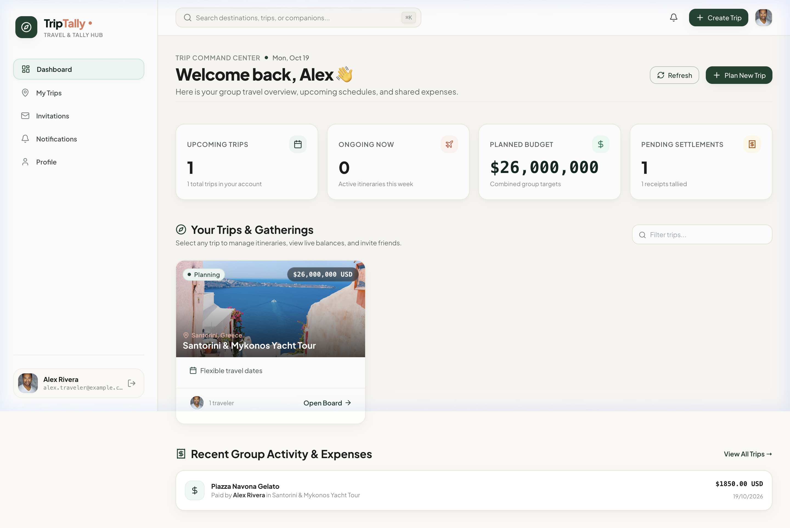
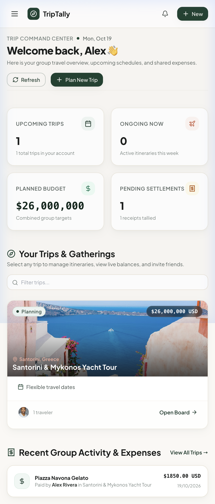
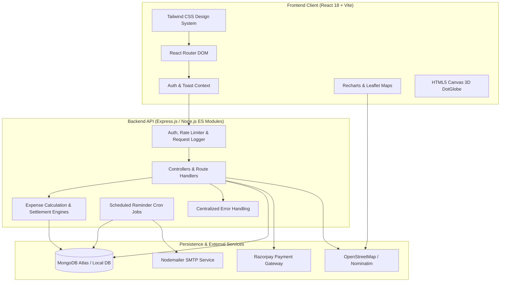

# TripTally — Collaborative Group Travel Planning & Expense Management

[-1B4332.svg)](https://github.com)
[](LICENSE)
[](https://vitejs.dev)
[](https://nodejs.org)
[](https://www.mongodb.com)

TripTally is a modern, collaborative group travel workspace and expense tallying platform. Designed with an editorial, boutique travel aesthetic — featuring a warm ivory canvas, deep forest green accents, terracotta highlights, and Google Fonts (*Plus Jakarta Sans* and *Playfair Display*).

---

## 📸 Application Preview

| Landing Hero with 3D DotGlobe | Collaborative Dashboard Overview |
| :---: | :---: |
|  |  |

| Trip Workspace & Itinerary Planner | Interactive Destination Map (Leaflet) |
| :---: | :---: |
|  |  |

| Tablet Responsive View (768px) | Mobile Responsive View (390px) |
| :---: | :---: |
|  |  |

---

## 🏛️ System Architecture

TripTally follows a decoupled, service-oriented architecture designed for scalability, deterministic monetary calculation, and strict authorization scoping:



---

## ✨ Features Breakdown

### 1. Trip Management & Workspaces
- Create, view, edit, archive, and delete trips with customizable cover images, dates, destinations, and budgets.
- Categorized views for **Upcoming**, **Ongoing**, and **Completed** expeditions.
- Scoped strictly to trips where the user is an owner or accepted member.

### 2. Collaborative Membership & Invitations
- Invite travel companions via email with unique, cryptographically secure 7-day invitation tokens.
- Role-based Access Control (RBAC):
  - **Owner**: Full administrative control, deletion, archiving, and role assignment.
  - **Organizer**: Can manage members, itineraries, and trip settings.
  - **Editor**: Can create and edit activities, log expenses, and update checklists.
  - **Viewer**: Read-only access to schedules, maps, and financial summaries.
- Local development fallback displays instant invitation URLs when SMTP is unconfigured.

### 3. Daily Itinerary Planner
- Day-by-day navigation for any trip date range.
- Timeline cards categorized by **Sightseeing**, **Dining**, **Lodging**, **Transport**, and **Activities**.
- Real-time planned cost aggregations per day and for the entire expedition.

### 4. Interactive Map View (OpenStreetMap & Leaflet)
- Automatic geocoding via OpenStreetMap Nominatim with in-memory caching and rate limiting.
- Plots destination stops, hotels, and attractions with custom map markers.
- Interactive detail popups and route lines connecting itinerary stops.
- 100% free and open-source — zero paid map tokens required.

### 5. Group Expense Management & Split Ledger
- Log expenses with title, category, date, payer, split participants, notes, and receipt uploads.
- Supports **Equal Splits** and deterministic **Custom Percentage / Fixed Splits**.
- All monetary amounts are stored authoritatively in integer minor units (e.g. cents, paise).
- Built-in debt simplification engine calculates net balances and provides a settlement transfer plan ("Who owes Whom").
- Manual settlements via Cash, UPI, Venmo, or Bank Transfer.

### 6. Budget Analytics & Aggregations
- Real-time KPI summaries: Total Budget, Spent Amount, Remaining Funds, and Burn Rate Percentage.
- Category-wise spending donut chart (Dining, Stays, Activities, Transport).
- Planned vs. Actual spending comparison charts and daily spending trends.
- Individual member contribution summary and configurable budget threshold alerts (e.g. 80%).

### 7. Shared Packing Checklist & Activity Feed
- Categorized packing items (**Clothing**, **Gear**, **Documents**, **Medicines**, **Electronics**).
- Assign items to individual companions with completion tracking.
- Immutable activity feed logging trip mutations (new activities, expenses, settlements).

### 8. In-App Notifications & Scheduled Reminders
- In-app notification center with read/unread statuses and bulk "Mark all as read".
- Automated background reminders for upcoming trips (24 hours prior) and pending debt balances.
- Configurable notification preferences (Email vs. In-App).

### 9. Razorpay Test-Mode Online Payments
- Standard merchant settlement collection flow.
- Server-side order creation and cryptographic HMAC SHA-256 signature verification.
- Idempotent webhook processing for `payment.captured`, `order.paid`, and `refund.processed`.
- Safe simulated fallback mode in local development when keys are not configured.

### 10. Design System & Accessibility
- Strict focus outlines (`:focus-visible`) for keyboard navigation.
- Accessible keyboard shortcuts: `⌘K` / `Ctrl+K` global search focus, `Escape` modal dismiss.
- `@media (prefers-reduced-motion: reduce)` support.
- Fully responsive across Desktop (1440px), Tablet (768px), and Mobile (390px).

---

## 🛠️ Tech Stack & Dependencies

### Frontend (`client/`)
- **Framework**: React 18 + Vite 6
- **Styling**: Tailwind CSS v3.4 + PostCSS + Autoprefixer
- **Icons**: Lucide React
- **Forms**: React Hook Form + Zod (`@hookform/resolvers`)
- **Maps**: Leaflet + React-Leaflet
- **Charts**: Recharts
- **3D Graphics**: HTML5 Canvas Particle DotGlobe (zero external 3D libraries)
- **Testing**: Vitest + React Testing Library + JSDOM

### Backend (`server/`)
- **Runtime**: Node.js v20+ (ES Modules)
- **Server Framework**: Express.js
- **Database**: MongoDB with Mongoose ODM
- **Authentication**: JWT stored in secure HTTP-only cookies + bcryptjs
- **Rate Limiting**: Custom sliding-window in-memory rate limiter (zero dependencies)
- **Logging**: Structured request logger with sensitive parameter masking
- **Payments**: Razorpay SDK + Webhook cryptographic verification
- **Testing**: Vitest + Supertest

---

## ⚡ Quick Start & Local Setup

### 1. Prerequisites
- **Node.js**: v18.0.0 or higher
- **npm**: v9.0.0 or higher
- **MongoDB**: Local MongoDB daemon running on `mongodb://localhost:27017` or MongoDB Atlas URI

### 2. Installation
Clone the repository and install all dependencies for both frontend and backend in one command:
```bash
git clone https://github.com/your-username/TripTally.git
cd TripTally
npm run install:all
```

### 3. Environment Configuration
Copy the example environment files:
```bash
cp server/.env.example server/.env
cp client/.env.example client/.env
```

Review `server/.env` (default values work out-of-the-box for local development):
```env
PORT=5001
NODE_ENV=development
CLIENT_URL=http://localhost:5173
MONGODB_URI=mongodb://localhost:27017/triptally
JWT_SECRET=supersecret_triptally_dev_key_change_in_production
JWT_EXPIRES_IN=7d
```

### 4. Running the Development Servers
Start both the Express API and Vite React frontend concurrently:
```bash
npm run dev
```

- **Frontend Client**: [http://localhost:5173](http://localhost:5173)
- **Backend API**: [http://localhost:5001](http://localhost:5001)
- **Design System Tokens Preview**: [http://localhost:5173/design-system](http://localhost:5173/design-system)

---

## 🔑 Environment Variables Reference

### Server Environment Variables (`server/.env`)

| Variable | Required | Default / Example | Purpose |
| :--- | :---: | :--- | :--- |
| `PORT` | No | `5001` | Express server port |
| `NODE_ENV` | Yes | `development` / `production` | Environment mode |
| `CLIENT_URL` | Yes | `http://localhost:5173` | Allowed CORS origin for cookies |
| `MONGODB_URI` | Yes | `mongodb://localhost:27017/triptally` | MongoDB connection string |
| `JWT_SECRET` | Yes | `supersecret_...` | Key used to sign authentication JWTs |
| `JWT_EXPIRES_IN` | No | `7d` | Token session validity duration |
| `RAZORPAY_KEY_ID` | Optional | `rzp_test_...` | Razorpay API Key ID (activates checkout) |
| `RAZORPAY_KEY_SECRET` | Optional | `secret_...` | Razorpay Key Secret for signature check |
| `RAZORPAY_WEBHOOK_SECRET` | Optional | `webhook_...` | HMAC secret for verifying webhooks |
| `SMTP_HOST` | Optional | `smtp.mailtrap.io` | SMTP server for email dispatch |
| `SMTP_PORT` | Optional | `2525` | SMTP port |
| `SMTP_USER` | Optional | `username` | SMTP username |
| `SMTP_PASS` | Optional | `password` | SMTP password |
| `EMAIL_FROM` | Optional | `"TripTally" <noreply@...>` | Outgoing sender header |

### Client Environment Variables (`client/.env`)

| Variable | Required | Default | Purpose |
| :--- | :---: | :--- | :--- |
| `VITE_API_URL` | No | `/api` | Base URL for API requests (proxied by Vite in dev) |

---

## 📡 REST API Documentation

All protected endpoints require an authenticated HTTP-only `token` cookie or `Authorization: Bearer <token>` header.

### Authentication (`/api/auth`)
| Method | Endpoint | Access | Description |
| :--- | :--- | :---: | :--- |
| `POST` | `/api/auth/register` | Public | Register new user account |
| `POST` | `/api/auth/login` | Public | Authenticate user and set HTTP-only cookie |
| `POST` | `/api/auth/logout` | Public | Clear authentication cookie |
| `GET` | `/api/auth/me` | Private | Retrieve authenticated user profile |
| `PUT` | `/api/auth/profile` | Private | Update display name and travel bio |
| `POST` | `/api/auth/forgot-password` | Public | Request password reset token |
| `PUT` | `/api/auth/reset-password/:token`| Public | Reset password using verified token |

### Trips & Collaboration (`/api/trips`)
| Method | Endpoint | Access | Description |
| :--- | :--- | :---: | :--- |
| `GET` | `/api/trips` | Private | List authorized trips (supports `?search=`, `?status=`, `?page=`) |
| `POST` | `/api/trips` | Private | Create a new trip board |
| `GET` | `/api/trips/:id` | Member | Retrieve trip details and member roster |
| `PUT` | `/api/trips/:id` | Organizer+ | Update title, destination, dates, budget |
| `PATCH`| `/api/trips/:id/archive` | Organizer+ | Toggle archived trip status |
| `DELETE`| `/api/trips/:id` | Owner | Delete trip and clean up associated records |
| `POST` | `/api/trips/:id/invitations` | Organizer+ | Invite companion by email |
| `DELETE`| `/api/trips/:id/members/:userId` | Organizer+ | Remove companion from trip |

### Daily Itinerary (`/api/trips/:tripId/itinerary`)
| Method | Endpoint | Access | Description |
| :--- | :--- | :---: | :--- |
| `GET` | `/api/trips/:tripId/itinerary` | Member | List activities ordered by date and time |
| `POST` | `/api/trips/:tripId/itinerary` | Editor+ | Schedule new activity with estimated cost |
| `PUT` | `/api/trips/:tripId/itinerary/:id` | Editor+ | Update activity details |
| `DELETE`| `/api/trips/:tripId/itinerary/:id` | Editor+ | Delete activity |

### Group Expenses & Settlements (`/api/trips/:tripId/expenses`)
| Method | Endpoint | Access | Description |
| :--- | :--- | :---: | :--- |
| `GET` | `/api/trips/:tripId/expenses` | Member | List logged expenses with category filters |
| `POST` | `/api/trips/:tripId/expenses` | Editor+ | Create expense with equal or custom splits |
| `GET` | `/api/trips/:tripId/expenses/balances` | Member | Calculate authoritative net balances and debt transfers |
| `POST` | `/api/trips/:tripId/expenses/upload-receipt` | Editor+ | Upload receipt image/PDF (max 5MB) |
| `POST` | `/api/trips/:tripId/settlements` | Editor+ | Record debt settlement |

### Budget Analytics & Checklist
| Method | Endpoint | Access | Description |
| :--- | :--- | :---: | :--- |
| `GET` | `/api/trips/:tripId/analytics` | Member | Aggregated budget metrics and charts |
| `PATCH`| `/api/trips/:tripId/budget-alert` | Organizer+ | Configure budget threshold percentage |
| `GET` | `/api/trips/:tripId/packing` | Member | List shared packing items |
| `POST` | `/api/trips/:tripId/packing` | Editor+ | Add checklist item with member assignment |
| `PATCH`| `/api/trips/:tripId/packing/:id/toggle` | Editor+ | Toggle item packed status |
| `GET` | `/api/trips/:tripId/activities` | Member | Paginated trip activity feed |

---

## 🧪 Testing Suite & Quality Assurance

TripTally includes comprehensive automated test suites covering UI workflows, backend API integration, deterministic mathematical models, rate limiting, and permission matrices.

```bash
# Run all tests (Server + Client)
npm test

# Run backend API tests only
npm --prefix server test

# Run frontend UI tests only
npm --prefix client test

# Run client production build
npm run build:client
```

### Test Coverage Results

- **Backend API Integration Tests**: **12 passed (12 files), 118 passed (118 tests)**
  - `server/src/test/securityAndEdgeCases.test.js` (Expired tokens, forged signatures, RBAC denials, rate limiting, log sanitization)
  - `server/src/test/paymentApi.test.js` (Razorpay orders, HMAC signatures, webhooks, idempotency)
  - `server/src/test/expenseCalculation.test.js` (Deterministic minor currency units, custom splits, debt simplification)
  - `server/src/test/expenseApi.test.js` (Expense CRUD, receipt uploads, settlements)
  - `server/src/test/trip.test.js` (Trip lifecycles, date validations, owner permissions)
  - `server/src/test/invitation.test.js` (Secure token hash generation, duplicate invites, role assignments)
  - `server/src/test/itinerary.test.js` (Timeline activities, date boundaries, reordering)
  - `server/src/test/notificationApi.test.js` (In-app notifications, preferences, scheduled reminders)
  - `server/src/test/packingAndActivityApi.test.js` (Packing checklist toggles, audit activity logs)
  - `server/src/test/auth.test.js` (Registration, login, password reset tokens, cookie security)
  - `server/src/test/health.test.js` (API health check and 404 responses)
  - `server/src/test/analyticsApi.test.js` (Aggregation pipelines, threshold limits)
- **Frontend Component & Workflow Tests**: **10 passed (10 files), 46 passed (46 tests)**
  - `client/src/test/tripWorkflow.test.jsx` (`CreateTripModal`, date range validation, `InviteMemberModal`)
  - `client/src/test/payments.test.jsx` (Razorpay checkout modal, disabled fallbacks, transaction history)
  - `client/src/test/notifications.test.jsx` (Filter tabs, mark all read, reminder preferences)
  - `client/src/test/expense.test.jsx` (Split forms, balance calculations, settlement modal)
  - `client/src/test/analytics.test.jsx` (Recharts containers, threshold modals, filters)
  - `client/src/test/auth.test.jsx` (Login, registration, protected route redirection)
  - `client/src/test/dashboard.test.jsx` (KPI counters, destination cards, upcoming trip carousels)
  - `client/src/test/map.test.jsx` (Leaflet container mounting, geocoding coordinates)
  - `client/src/test/packingAndActivity.test.jsx` (Checklist assignments, progress bars, activity logs)
  - `client/src/test/components.test.jsx` (Button variants, Dialogs, Badges, Skeletons)
- **Overall Total**: **164 / 164 Tests Passing (100% Green)**.

---

## 🎯 Evaluator Demo Workflow

To test the application end-to-end as an evaluator:

1. **Launch the Application**: Run `npm run dev` and navigate to [http://localhost:5173](http://localhost:5173).
2. **Instant 1-Click Demo Login**:
   - On the landing page, click **"Sign In"** in the top navigation.
   - Click the **"1-Click Guest Demo"** button (`alex.traveler@example.com`).
   - You are immediately authenticated with a pre-configured sample profile.
3. **Explore the Collaborative Dashboard**:
   - Notice the upcoming trips, active expeditions, and KPI counters.
   - Press `⌘K` or `/` on your keyboard to instantly focus the search bar.
4. **Enter a Trip Workspace**:
   - Click on the **"Amalfi Coast Roadtrip & Capri Sailing"** expedition.
   - **Itinerary Tab**: View daily activities with timing, locations, and planned expenses. Add a new activity or view the Day-by-Day schedule.
   - **Map Tab**: Switch to the interactive Leaflet map to inspect markers plotted along the Italian coast.
   - **Expenses Tab**: Review the group tally. Inspect the net balances ("Who Owes Whom").
   - **Settle Up**: Click "Settle Debt" to record a cash payment or test Razorpay online payment simulation.
   - **Analytics Tab**: Examine real-time category donut charts, daily spend trends, and budget burn rate.
   - **Packing Tab**: Check off packing essentials or assign items to companions.
   - **Activity Tab**: Review the audit log of all changes made to the trip.
5. **Mobile & Tablet Responsiveness**:
   - Resize your browser window or switch to device emulation (iPad or iPhone).
   - Notice the smooth mobile drawer menu, touch-friendly buttons (≥44px), and responsive grids.

---

## 🚢 Production Deployment Guide

### Option A: Full-Stack on Render / Railway
1. **Database**: Create a free MongoDB database on [MongoDB Atlas](https://www.mongodb.com/atlas). Obtain your connection URI.
2. **Web Service**: Connect your GitHub repository to Render or Railway.
3. **Root Directory**: Deploy the `server` directory as the Node.js application:
   - Build Command: `npm install`
   - Start Command: `npm start`
4. **Static Site**: Deploy `client` to Vercel or Netlify:
   - Build Command: `npm run build`
   - Output Directory: `dist`
   - Environment Variable: `VITE_API_URL=https://your-api-domain.com/api`
5. **CORS**: Set `CLIENT_URL=https://your-client-domain.com` in your backend environment variables.

---

## ⚠️ Known Limitations & Considerations

1. **Email Service in Local Development**: When SMTP credentials are not specified in `.env`, invitation links and notification reminders are logged directly to the server terminal output rather than being sent over the network.
2. **Razorpay Merchant Collection**: Standard Razorpay checkout collects funds into the trip's verified merchant account; peer-to-peer wallet balances are recorded in the authoritative database ledger without requiring third-party custodial wallet integrations.
3. **OpenStreetMap Nominatim Geocoding**: Nominatim requests are rate-limited to 1 request per second in compliance with OpenStreetMap's usage policy; verified coordinates are cached in-memory.

---

## 📄 License

This project is licensed under the MIT License. See [LICENSE](LICENSE) for details.
