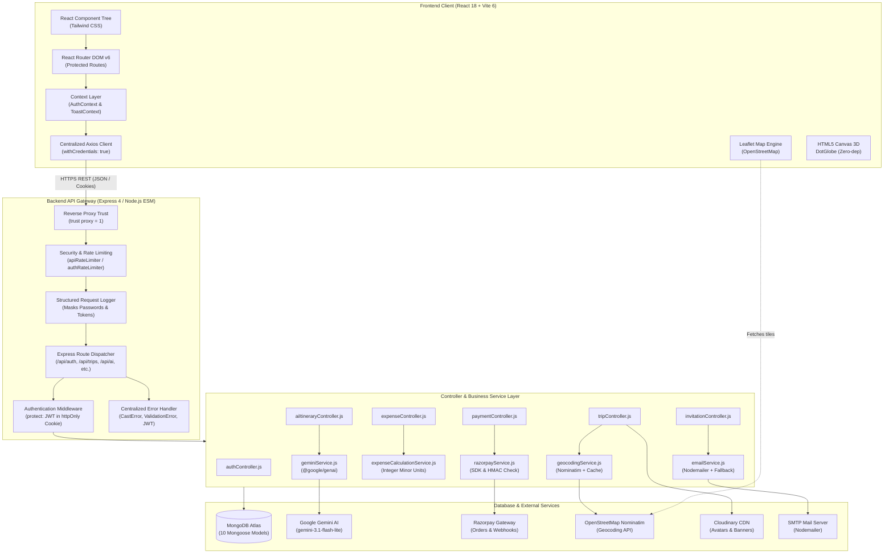
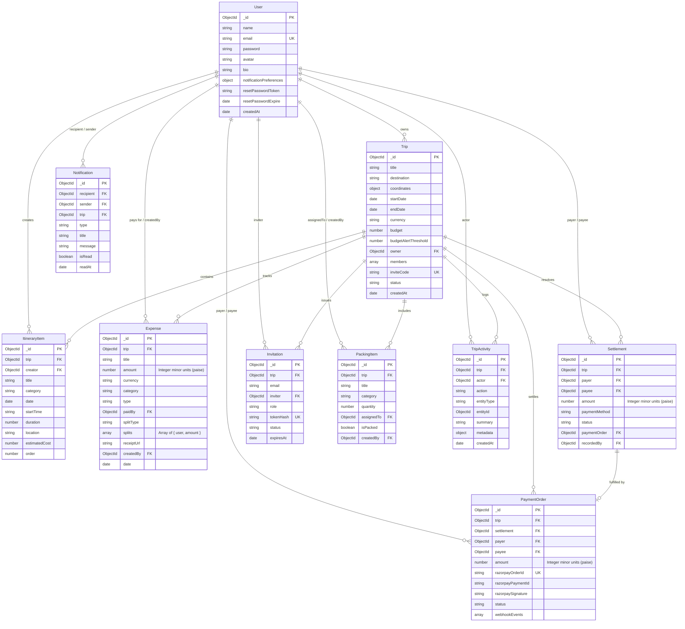
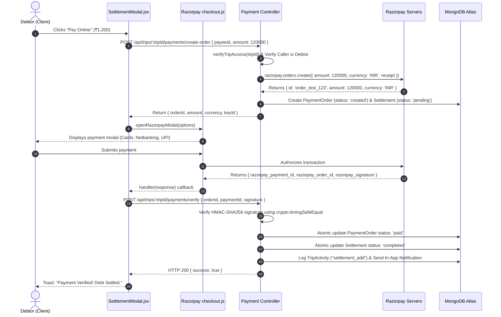

# TripTally — Master Technical Architecture & Software Interview Preparation Guide

> **Project Name:** TripTally — AI-Powered Collaborative Travel Planner & Expense Hub  
> **Tech Stack:** MongoDB, Express.js, React 18, Node.js (MERN) + Google Gemini AI (`@google/genai`) + Razorpay Payment Gateway + Leaflet/OpenStreetMap + Cloudinary CDN  
> **Target Audience:** Full-Stack Web Development Interviewers, System Architecture Reviewers, Technical Leads  
> **Author & Developer:** Vivek Kumar  

---

## 📑 Table of Contents

1. [Section 1: Project Overview & "Elevator Pitch"](#section-1-project-overview)
2. [Section 2: Technology Stack & Technical Justifications](#section-2-technology-stack)
3. [Section 3: System Architecture & Data Flow](#section-3-project-architecture)
4. [Section 4: Comprehensive Folder & File Structure](#section-4-folder-and-file-structure)
5. [Section 5: Complete Application User Workflows (17 Journeys)](#section-5-complete-application-workflow)
6. [Section 6: Frontend Architecture & Deep Dive](#section-6-frontend-deep-dive)
7. [Section 7: Backend Architecture & Request Lifecycle](#section-7-backend-deep-dive)
8. [Section 8: MongoDB Schema Design & Data Models](#section-8-mongodb-and-database-design)
9. [Section 9: Authentication, Authorisation & Session Security](#section-9-authentication-and-authorisation)
10. [Section 10: Google Gemini AI Integration — Detailed Technical Breakdown](#section-10-gemini-ai-integration)
11. [Section 11: Razorpay Payment Gateway — Complete Integration & Webhooks](#section-11-razorpay-payment-gateway)
12. [Section 12: Collaborative Trip Planning & Permission Scoping](#section-12-collaborative-trip-planning)
13. [Section 13: Expense Splitting, Ledger Mathematics & Debt Simplification](#section-13-expense-splitting-and-budget-management)
14. [Section 14: REST API Documentation (35+ Endpoints)](#section-14-api-documentation)
15. [Section 15: Third-Party Integrations & External Services](#section-15-third-party-integrations)
16. [Section 16: Security Implementation, Hardening & Error Handling](#section-16-security-and-error-handling)
17. [Section 17: Deployment, Serverless Architecture & Environment Setup](#section-17-deployment-and-environment-setup)
18. [Section 18: Performance, Scalability & Production Evolution](#section-18-performance-scalability-and-future-improvements)
19. [Section 19: Comprehensive Technical Interview Question Bank (150+ Questions)](#section-19-complete-interview-question-bank)
20. [Section 20: Scenario-Based, Edge Cases & Tricky Interview Scenarios](#section-20-scenario-based-and-tricky-interview-questions)
21. [Section 21: Critical Code Walkthroughs (Line-by-Line Explanations)](#section-21-important-code-walkthroughs)
22. [Section 22: Quick Revision Sheet & Verbal Interview Script](#section-22-quick-revision-sheet)

---

<a name="section-1-project-overview"></a>
## Section 1: Project Overview

### 1.1 What is TripTally?
**TripTally** is a full-stack, collaborative group travel workspace and expense tallying web application. It combines automated, generative day-by-day itinerary planning powered by Google Gemini AI with multi-member collaboration, interactive geospatial mapping (OpenStreetMap/Leaflet), shared packing checklists, real-time audit logging, and a deterministic financial ledger with debt simplification and online settlement collection via Razorpay.

The application is tailored with an editorial travel aesthetic (warm ivory canvas, deep forest green accents, terracotta highlights) and is specifically optimized for Indian and international travelers with native support for Indian Rupee (`₹`) minor currency units (**paise**), domestic travel circuits (e.g., Manali, Goa, Rishikesh, Kerala, Jaipur), and UPI/Razorpay payment flows.

### 1.2 What Problem Does It Solve?
Planning a trip with friends or colleagues is notoriously fragmented across disconnected tools:
1. **Itinerary Chaos:** Travel research is scattered across Google Docs, WhatsApp chats, and travel blogs, resulting in unrealistic travel schedules with geographical zig-zagging.
2. **Financial Awkwardness & Debt Confusion:** Friends pay for meals, cabs, and hotels at different times. Calculating who owes whom at the end of the trip involves complex arithmetic, rounding errors, and social friction.
3. **Collaboration Friction:** Lack of centralized permissions leads to accidental deletions or confusion over bookings and packing responsibilities.
4. **Currency & Payment Barriers:** Most global travel apps only support US Dollars and lack native integration with Indian Rupees, UPI payments, and Indian banking gateways.

TripTally solves this by unifying **AI generation, real-time trip scheduling, packing coordination, and a zero-sum integer debt engine** into a single collaborative web workspace.

### 1.3 Who Uses It?
- **Friend Groups & Families:** Planning vacations where costs need to be shared fairly and activities scheduled cooperatively.
- **Backpackers & Adventure Travelers:** Solo or duo explorers looking to instantly generate comprehensive, realistic day-by-day plans within a fixed budget.
- **Corporate Offsite & College Trip Organizers:** Requiring role-based access control (Organizers, Editors, Viewers) and budget threshold alerts to keep expenditures under control.

### 1.4 What Makes TripTally Superior to a Basic Travel App?
| Feature Dimension | Basic Student / MVP Project | TripTally Implementation |
| :--- | :--- | :--- |
| **Itinerary Generation** | Static mock data or hardcoded templates | Real generative AI via official `@google/genai` SDK using `gemini-3.1-flash-lite`, outputting structured JSON with Zod validation, geographical sequencing, and 1-click database persistence. |
| **Financial Ledger** | Floating-point math (`amount / count`) vulnerable to IEEE 754 precision bugs | Authoritative integer minor units (**paise**, where ₹1 = 100 paise) with deterministic remainder distribution and greedy debt simplification. |
| **Payment Flow** | Fake UI buttons that simulate payment | Full Razorpay SDK integration: server-side order generation, client checkout, HMAC SHA-256 signature verification with `crypto.timingSafeEqual`, and raw-body idempotent webhook processing. |
| **Collaboration** | Open editing with no permissions | Cryptographic SHA-256 hashed 7-day email invitations with Role-Based Access Control (**Owner**, **Organizer**, **Editor**, **Viewer**). |
| **Mapping & Location** | Static images or expensive Google Maps API keys | OpenStreetMap Nominatim geocoding with in-memory caching and 1s rate limiting, plotted onto interactive Leaflet maps. |
| **Test Coverage** | None or simple sanity checks | **187 passing automated tests** (135 backend tests with Supertest/Vitest, 52 frontend tests with React Testing Library/Vitest). |

---

### 1.5 Interview-Ready "Elevator Pitch": "Tell Me About Your TripTally Project"

#### ⏱️ The 30-Second Answer
> *"TripTally is an AI-powered collaborative group travel planner and expense management platform built on the MERN stack. It allows travel groups to generate structured, day-by-day itineraries using Google Gemini AI, collaborate in real time with role-based permissions, track shared expenses in Indian Rupees down to the exact paisa, simplify peer-to-peer debts, and settle balances online via Razorpay. I engineered it with production resilience in mind, featuring server-side HMAC signature verification, zero-dependency in-memory rate limiting, and 187 automated unit and integration tests."*

#### ⏱️ The 1-Minute Answer
> *"TripTally addresses the fragmentation of group travel planning. When planning a trip, groups usually juggle WhatsApp chats, spreadsheets, and payment apps. TripTally brings this into one platform:*
> *First, it leverages Google Gemini AI via the official `@google/genai` SDK to convert simple destination and budget inputs into complete, geographically sequenced daily itineraries with budget breakdowns and packing checklists.*
> *Second, it provides a collaborative workspace where trip organizers can invite companions with secure 7-day cryptographic tokens and enforce Role-Based Access Control—ranging from Owners and Organizers down to read-only Viewers.*
> *Third, it features a deterministic expense engine. To eliminate floating-point rounding errors common in JavaScript financial apps, all monetary values are stored in integer minor units—paise. It supports equal splits with automated remainder distribution, custom splits, and a greedy debt simplification algorithm that computes the minimum transactions needed to settle debts.*
> *Finally, I integrated Razorpay for payment settlements, implementing server-side order generation, timing-safe cryptographic HMAC-SHA256 signature verification, and idempotent webhook handling. The entire system is covered by 187 automated tests."*

#### ⏱️ The 2-Minute Technical Deep Dive
> *"Architecturally, TripTally is a decoupled client-server web application designed for deterministic financial tracking and high security. The frontend is built with React 18, Vite, and Tailwind CSS, utilizing React Hook Form with Zod for client validation, Recharts for financial analytics, and Leaflet for OpenStreetMap rendering without paid API keys.*
>
> *The backend is an Express.js server running in Node.js ES Modules backed by MongoDB and Mongoose. For session security, I rejected storing JWTs in localStorage due to XSS vulnerabilities; instead, the application issues JSON Web Tokens stored in secure, `httpOnly`, `sameSite` cookies with reverse proxy support. API protection includes a custom sliding-window in-memory rate limiter with automated memory cleanup, structured request logging that masks sensitive fields like passwords and tokens, and centralized error handling that normalizes Mongoose validation and cast errors.*
>
> *Our Gemini AI service uses `gemini-3.1-flash-lite` with automatic fallback to `gemini-3.8-flash`. I engineered strict prompt constraints instructing the model to output pure JSON matching our Zod schema. If the model returns malformed JSON or markdown fences, the backend strips the fences, validates the shape, recalculates duration dates, and provides a 1-click endpoint that persists the generated plan into MongoDB as synchronized Trip, ItineraryItem, and PackingItem documents.*
>
> *On the financial side, monetary calculations strictly use integer minor currency units—100 paise per Rupee. The balance engine calculates net balances, verifies the zero-sum invariant, and runs a two-pointer greedy graph simplification algorithm to produce a minimal settlement transfer list. For online settlements, the server creates Razorpay orders with server-calculated amounts, opens Razorpay's checkout modal on the frontend, and verifies payments on the backend using `crypto.timingSafeEqual` over HMAC-SHA256 digests. Webhooks are verified against captured raw request buffers and recorded idempotently in a subdocument array.*
>
> *The codebase contains 10 Mongoose models, 35+ REST endpoints, and has 187 automated Vitest unit and integration tests covering security, permission matrices, mathematical ledger invariants, and simulated mock AI responses."*

---

<a name="section-2-technology-stack"></a>
## Section 2: Technology Stack & Technical Justifications

### 2.1 Complete Technology Matrix
The following table documents the technologies used in the codebase:

| Technology / Library | Layer / Location | Purpose | Why It Was Selected | Alternative Considered & Rejected |
| :--- | :--- | :--- | :--- | :--- |
| **React 18** (`^18.3.1`) | Frontend (`client/`) | Component-based UI library | Concurrent rendering, stable hooks ecosystem (`useState`, `useEffect`, `useCallback`, `useContext`), virtual DOM diffing. | Plain JavaScript (unmaintainable DOM manipulation) or Angular (too heavy for this scope). |
| **Vite 6** (`^6.1.0`) | Frontend Build Tool | Bundler and dev server | Instant hot module replacement (HMR) powered by ES modules, fast Rollup production builds. | Create React App / Webpack (deprecated, slow cold starts, bloated configs). |
| **Tailwind CSS** (`^3.4.17`) | Frontend Styling | Utility-first CSS styling | Rapid UI composition, zero stylesheet bloat via tree-shaking (purge), consistent design tokens for editorial palette. | Vanilla CSS (slow to scale) or Tailwind v4 (experimental at project inception). |
| **React Router DOM** (`^6.29.0`) | Frontend Routing | Client-side routing & navigation | Declarative nested routing, path param extraction (`/trips/:id`), programmatic redirects, protected route guards. | Browser History API manual routing. |
| **Axios** (`^1.7.9`) | Frontend API Client | HTTP communication | Centralized instance configuration, automatic JSON transformation, `withCredentials: true` cookie support, response interceptors. | Native `fetch` (requires manual error response checks and cookie credential boilerplate). |
| **React Hook Form** (`^7.54.2`) | Frontend Forms | Form state management | Uncontrolled form inputs preventing unnecessary component re-renders, lightweight bundle size. | Formik (heavier bundle, slower performance on complex multi-field forms). |
| **Zod** (`^3.24.2`) | Full Stack (`client` & `server`) | Runtime schema validation | TypeScript-like schema declaration, isomorphic validation on forms and backend payloads, strict Gemini JSON schema enforcement. | Joi / Yup (Zod integrates seamlessly with `@hookform/resolvers` and modern TS/ESM). |
| **Recharts** (`^2.15.1`) | Frontend Analytics | Data visualization | Declarative SVG-based charts, responsive container support, smooth animations for budget breakdown and spend trends. | Chart.js (canvas-based, less idiomatic in React component hierarchies). |
| **Leaflet** (`^1.9.4`) | Frontend Maps | Interactive geographic maps | Lightweight, mobile-friendly interactive mapping, custom SVG pins, zero API key requirement with OpenStreetMap. | Google Maps JavaScript API (expensive credit card billing requirement). |
| **HTML5 Canvas 3D** | Frontend Landing Page | Interactive globe visualization | Hand-crafted particle math on HTML5 2D canvas context simulating a 3D rotating dot globe with zero external 3D libraries. | Three.js / Fiber (saved ~600KB bundle size by writing raw canvas math). |
| **Node.js** (`v20+`) | Backend Runtime | JavaScript runtime environment | Asynchronous non-blocking I/O, native ES Modules (`import`/`export`), single language across frontend and backend. | Python/Django (slower JSON serialization, language context switching). |
| **Express.js** (`^4.21.2`) | Backend Framework | REST API web framework | Minimalist, robust middleware pipeline, flexible routing, battle-tested production reliability. | NestJS (unnecessary TypeScript/decorator abstraction) or Fastify. |
| **MongoDB Atlas** | Database | NoSQL Document Database | Flexible schema for nested trip itineraries, packing checklists, dynamic activity metadata, native JSON-like BSON storage. | PostgreSQL (relational rigid schemas require multi-table joins for deeply nested day plans). |
| **Mongoose ODM** (`^8.9.5`) | Backend Database ODM | Object Data Modeling | Schema validation, pre-save hooks (bcrypt password hashing, invite code generation), model methods, reference population (`populate`). | Native MongoDB Node Driver (lacks automated schema validation and lifecycle hooks). |
| **JSON Web Tokens** (`^9.0.2`) | Backend Auth | Stateless token authentication | Cryptographically signed identity payload (`{ id, email, name }`), verified without database session lookup if desired. | Server-side express-session (requires Redis storage to scale across multiple server instances). |
| **bcryptjs** (`^3.0.2`) | Backend Security | Password hashing | One-way salted hashing with 10 salt rounds, immune to rainbow table attacks, pure JS implementation avoiding node-gyp build failures. | Plain MD5/SHA-256 (unsafe for passwords) or native `bcrypt` (causes native compile errors in serverless). |
| **@google/genai** (`^2.30.0`) | Backend AI Integration | Google Gemini AI SDK | Official Google Generative AI SDK supporting `gemini-3.1-flash-lite` and `gemini-3.8-flash`, structured JSON output mode, configurable temperature. | LangChain (bloated abstraction layer for a direct LLM call). |
| **Razorpay Node SDK** (`^2.9.8`)| Backend Payments | Payment gateway integration | Official payment SDK for creating orders, managing settlements, and handling INR currency flows. | Stripe (poor native UPI support in India compared to Razorpay). |
| **Multer** (`^1.4.5-lts.1`) | Backend File Upload | Multipart form-data parser | Streaming file uploads with disk storage, file extension normalization, and 5MB/10MB file size limits. | Formidable or Busboy (Multer provides cleaner Express middleware integration). |
| **Cloudinary** (`^2.5.1`) | Backend Media Storage | Cloud media CDN | Secure cloud hosting for profile avatars and trip cover banners with auto-optimization, with automatic local disk fallback. | AWS S3 (requires complex IAM and bucket policy setup for simple photo uploads). |
| **Nodemailer** (`^10.1.7`) | Backend Email | SMTP email dispatch | Standard Node.js email client supporting custom HTML invitation emails, with graceful console logging fallback in dev. | SendGrid / Resend (requires verified domain and paid plans for developer testing). |
| **Vitest** (`^3.0.5`) | Testing Suite | Automated test runner | Extremely fast, native Vite/ESM support, Jest-compatible assertions, integrated coverage reporting. | Jest (difficult configuration with modern ES Modules and Vite aliases). |
| **Supertest** (`^7.0.0`) | Backend Integration Testing| HTTP assertions | Testing Express API endpoints in memory without binding to network ports. | Manual Postman testing. |

---

### 2.2 Core Architectural Interview Questions & Answers

#### Q1: Why did you choose the MERN stack for TripTally?
**Answer:**  
The MERN stack (MongoDB, Express, React, Node.js) allows full-stack development using a single programming language—modern JavaScript (ES Modules).  
1. **JSON as the Universal Format:** Data flows seamlessly as JSON from the React frontend, through the Express REST endpoints, to MongoDB's native BSON storage, and into Google Gemini's JSON structured output. No object-relational mapping impedance mismatch occurs.
2. **Asynchronous Non-Blocking I/O:** Node.js and Express excel at handling I/O-heavy operations, such as awaiting multiple third-party API calls (Gemini AI generation, Razorpay order creation, OpenStreetMap geocoding, and Cloudinary media uploads) concurrently without thread starvation.
3. **Rich Ecosystem:** The NPM ecosystem provides battle-tested packages for every domain requirement: `@google/genai`, `razorpay`, `mongoose`, `zod`, and `leaflet`.

#### Q2: Why React instead of plain Vanilla JavaScript?
**Answer:**  
TripTally has complex, state-heavy interactive interfaces:
- An AI planner that manages interactive day tabs, inline activity editing, live cost recalculation, and packing checklists.
- A financial manager that calculates real-time net balances, updates split distributions, and toggles between settlement ledgers and transaction logs.
- An interactive Leaflet map that synchronizes markers with selected itinerary days.

In vanilla JavaScript, updating the DOM requires imperatively querying nodes (`document.getElementById`) and manually syncing data across views, which is prone to state synchronization bugs and memory leaks. React’s declarative component model, state hooks (`useState`, `useContext`), and Virtual DOM reconciliation ensure that the UI automatically re-renders when backend data or user state changes.

#### Q3: What is the exact role of Node.js in your application?
**Answer:**  
Node.js is the asynchronous runtime environment that executes our backend JavaScript code outside the browser. It runs our Express server, coordinates database queries via Mongoose, handles cryptographic operations (HMAC-SHA256 signature checks, bcrypt hashing), interacts with external APIs (Gemini, Razorpay, Nominatim), and manages scheduled background reminders.

#### Q4: Why use Express.js on top of Node.js?
**Answer:**  
Node's native `http` module only provides raw request and response streams (`http.createServer((req, res) => ...)`). Parsing query parameters, handling JSON request bodies, configuring CORS headers, extracting cookies, managing route parameters (like `req.params.tripId`), and chaining middleware must all be written manually.  
Express provides a clean, modular middleware architecture (`app.use()`), robust pattern-based routing (`router.route('/:tripId/expenses')`), and standardized error handling pipelines.

#### Q5: Why MongoDB instead of a Relational Database like PostgreSQL?
**Answer:**  
Trip plans have inherently hierarchical, semi-structured data:
- A single `Trip` contains multiple `ItineraryItem` documents, shared `PackingItem` checklists, and member permission arrays.
- Different itinerary activities have varying metadata (a flight has departure/arrival and baggage rules; a hotel has check-in times; a museum has ticket pricing and booking notes).
- Document-oriented storage allows saving an entire AI-generated travel plan with variable days and activity attributes without executing multiple complex relational joins across 5–6 normalized SQL tables.  
*Note:* For monetary integrity, while relational databases are traditionally favored for ACID transactions, MongoDB provides full document-level atomicity, and we enforce financial precision by storing integer minor currency units (paise) with deterministic schema validation rules.

#### Q6: What does Mongoose do that the native MongoDB driver doesn't?
**Answer:**  
The native MongoDB driver allows inserting any arbitrary JSON document into any collection without validation. Mongoose adds an **Object Data Modeling (ODM)** layer that provides:
1. **Strict Schema Definitions:** Enforces types, required fields, enum constraints (e.g. `role: ['organizer', 'editor', 'viewer']`), and custom validators (e.g. `Number.isInteger` on monetary amounts).
2. **Lifecycle Hooks (Middleware):** Pre-save hooks automatically hash user passwords via bcrypt (`userSchema.pre('save')`) and generate random cryptographic invite codes (`tripSchema.pre('save')`).
3. **Virtuals & Population:** The `populate()` method resolves foreign ObjectId references (e.g., expanding `payer: ObjectId` into `{ _id, name, email, avatar }`).
4. **Custom Methods:** Encapsulating domain logic directly on documents, such as `userSchema.methods.comparePassword()`.

#### Q7: How does the frontend communicate with the backend?
**Answer:**  
The frontend communicates with the backend exclusively via **RESTful JSON HTTP APIs** over HTTPS/HTTP. We use a centralized Axios instance located in [`client/src/lib/api.js`](file:///Users/vivekkumar/Downloads/TripTally/client/src/lib/api.js) configured with:
- `baseURL: import.meta.env.VITE_API_URL || '/api'`
- `withCredentials: true` (ensuring that HTTP-only session cookies are automatically attached to cross-site and same-site requests).
- Response interceptors that normalize backend error messages into JavaScript `Error` objects for consistent toast notifications.

#### Q8: What exact steps occur when the backend server boots up?
**Answer:**  
When `npm run dev:server` (running `server/src/server.js`) is executed:
1. `dotenv.config()` loads environment variables from `.env` into `process.env`.
2. `connectDB()` in [`server/src/config/db.js`](file:///Users/vivekkumar/Downloads/TripTally/server/src/config/db.js) initiates a cached connection to MongoDB Atlas or local MongoDB using `mongoose.connect()`.
3. The Express application (`server/src/app.js`) is instantiated.
4. Top-level middlewares are registered: database availability check, proxy trust setting (`app.set('trust proxy', 1)`), static file hosting for `/uploads` with security headers (`X-Content-Type-Options: nosniff`), structured request logger (`requestLogger`), CORS origin validation, body parsers (`express.json({ verify: ... })` which captures `req.rawBody` for webhook verification), and cookie parser (`cookieParser()`).
5. Application routes are mounted: `/api/health`, `/api/auth`, `/api/trips`, `/api/invitations`, `/api/notifications`, `/api/payments`, and `/api/ai`.
6. Rate limiters are activated: general limiter on `/api` (300 req/15 min), stricter limiters on auth (50 req/15 min), and AI generation (20 req/15 min).
7. Error-handling middleware (`notFound` and `errorHandler`) are attached at the very end of the stack.
8. `app.listen(PORT)` begins accepting incoming TCP connections on port 5001 (or `process.env.PORT`), and graceful shutdown listeners (`SIGTERM`) are registered.

---

<a name="section-3-project-architecture"></a>
## Section 3: Project Architecture

### 3.1 Architecture Overview
TripTally follows a **decoupled, service-oriented client-server architecture**. The presentation layer (React 18 SPA) is completely isolated from the business logic layer (Express.js), which coordinates persistence (MongoDB) and third-party infrastructure (Google Gemini, Razorpay, Cloudinary, OpenStreetMap Nominatim, and SMTP).



---

### 3.2 End-to-End Request-Response Lifecycle
When a user clicks **"Save & Convert to Collaborative Trip"** in the AI Trip Planner:

```mermaid
sequenceDiagram
    autonumber
    actor User as User (Browser)
    participant React as React (AiTripPlannerPage)
    participant Axios as Axios (api.js)
    participant Express as Express (app.js)
    participant RateLimit as rateLimiter.js
    participant Auth as auth.js (protect)
    participant Controller as aiItineraryController.js
    participant Geocoder as geocodingService.js
    participant Mongoose as Mongoose Models
    participant Mongo as MongoDB Atlas

    User->>React: Clicks "Save to My Trips"
    React->>Axios: POST /api/ai/itinerary/save (payload: generated plan)
    Axios->>Express: HTTP POST with httpOnly Cookie: token=jwt...
    Express->>RateLimit: Check IP request window (apiRateLimiter)
    RateLimit->>Auth: Verify JWT from cookie
    Auth->>Mongoose: User.findById(decoded.id)
    Mongoose->>Mongo: Query User
    Mongo-->>Auth: Return User document
    Auth->>Controller: req.user attached; invoke saveAiItinerary()
    Controller->>Geocoder: geocodeLocation(destination)
    Geocoder-->>Controller: Return { lat: 32.24, lng: 77.18 }
    Controller->>Mongoose: new Trip({ ... }).save()
    Mongoose->>Mongo: Insert Trip document
    Controller->>Mongoose: ItineraryItem.insertMany(activities)
    Mongoose->>Mongo: Bulk insert scheduled activities
    Controller->>Mongoose: PackingItem.insertMany(checklist)
    Mongoose->>Mongo: Bulk insert packing checklist
    Controller->>Mongoose: logTripActivity("trip_create")
    Mongoose->>Mongo: Insert Audit Log document
    Controller-->>Express: res.status(201).json({ success: true, tripId })
    Express-->>Axios: HTTP 201 Created
    Axios-->>React: Promise resolved
    React-->>User: Toast "Trip Saved!", navigate to /trips/:id
```

---

<a name="section-4-folder-and-file-structure"></a>
## Section 4: Comprehensive Folder & File Structure

```
TripTally/
├── package.json               # Root monorepo workspace scripts (concurrently dev, install, build)
├── vercel.json                # Vercel serverless deployment routing & rewrites
├── README.md                  # Public overview, screenshots, badges & quickstart
├── interview.md               # This complete technical documentation & interview guide
├── api/
│   └── index.js               # Vercel Serverless Function entry point wrapping Express app
│
├── client/                    # React 18 Frontend SPA
│   ├── package.json           # Frontend dependencies (React, Vite, Tailwind, Recharts, Leaflet)
│   ├── vite.config.js         # Vite configuration with proxy rules (/api -> localhost:5001)
│   ├── tailwind.config.js     # Editorial design system tokens (forest, terracotta, sand, ivory)
│   ├── index.html             # Single Page Application HTML host
│   └── src/
│       ├── main.jsx           # React DOM root render & StrictMode
│       ├── App.jsx            # Top-level Router configuration & route shells
│       ├── index.css          # Tailwind base, typography fonts, and custom CSS variables
│       ├── lib/
│       │   └── api.js         # Configured Axios instance withCredentials and error interceptor
│       ├── context/
│       │   ├── AuthContext.jsx # Global user auth state, session check, login, logout, register
│       │   └── ToastContext.jsx# Toast notification banner provider (success, error, info)
│       ├── pages/
│       │   ├── HomePage.jsx          # Public landing page with 3D canvas DotGlobe and circuits
│       │   ├── LoginPage.jsx         # User login form with 1-click guest demo login
│       │   ├── RegisterPage.jsx      # New account registration form
│       │   ├── ForgotPasswordPage.jsx# Email form to request password reset token
│       │   ├── ResetPasswordPage.jsx # Password reset submission page using token from URL
│       │   ├── DashboardPage.jsx     # Aggregated user dashboard with KPI summary & active trips
│       │   ├── TripsListPage.jsx     # Filterable list of user trips (upcoming, ongoing, completed)
│       │   ├── TripDetailsPage.jsx   # Main trip workspace container with tabs
│       │   ├── AiTripPlannerPage.jsx # Comprehensive Gemini AI trip generation interface
│       │   ├── InvitationsPage.jsx   # List of pending invitations with 1-click accept/decline
│       │   ├── NotificationsPage.jsx # In-app notification center & reminder preference settings
│       │   └── ProfilePage.jsx       # User profile details, avatar upload, and bio editor
│       ├── components/
│       │   ├── auth/ProtectedRoute.jsx # Route guard redirecting unauthenticated users to /login
│       │   ├── layout/       # Header, Footer, and public layout shell
│       │   ├── dashboard/    # Dashboard layout and sidebar navigation
│       │   ├── trips/        # Trip cards, creation modal, and banner uploader
│       │   ├── itinerary/    # Timeline day planner, activity forms, and cost summaries
│       │   ├── expenses/     # Expense ledger, split breakdown, and SettlementModal (Razorpay)
│       │   ├── map/          # Interactive Leaflet map container and destination pins
│       │   ├── analytics/    # Recharts budget charts, burn rate KPI, and threshold alerts
│       │   ├── packing/      # Categorized packing checklist and member assignment
│       │   ├── activity/     # Trip audit activity timeline feed
│       │   └── ui/           # Reusable UI primitives (Button, Dialog, Badge, Input, Card)
│       ├── services/
│       │   ├── authService.js # Auth API methods (login, register, logout, profile)
│       │   ├── tripService.js # Trip, Itinerary, Expense, Packing, & Payment API methods
│       │   └── aiService.js   # Gemini AI generation, day regeneration, & saving API calls
│       └── utils/
│           └── razorpay.js    # Dynamic checkout.js script loader and Razorpay modal launcher
│
└── server/                    # Express.js REST API Backend
    ├── package.json           # Backend dependencies (@google/genai, razorpay, mongoose, etc.)
    └── src/
        ├── server.js          # Standalone HTTP server listener and graceful shutdown
        ├── app.js             # Express app setup, middlewares, routes, and error handlers
        ├── config/
        │   ├── db.js          # Mongoose connection manager with serverless promise caching
        │   └── cloudinary.js  # Cloudinary SDK client configuration
        ├── middleware/
        │   ├── auth.js          # protect middleware, sendTokenResponse, clearTokenResponse
        │   ├── errorHandler.js  # Centralized error handler normalizing Mongoose & JWT errors
        │   ├── rateLimiter.js   # Custom sliding-window in-memory rate limiters (API, Auth, AI)
        │   ├── requestLogger.js # Structured request logger masking passwords and tokens
        │   └── upload.js        # Multer disk storages with filters for receipts, avatars, banners
        ├── models/
        │   ├── User.js          # User schema with bcrypt pre-save hashing & reset tokens
        │   ├── Trip.js          # Trip schema with member roles, budget threshold, inviteCode
        │   ├── ItineraryItem.js # Scheduled activities with category, timing, and estimated cost
        │   ├── Expense.js       # Expense schema with integer minor-unit amount & splits
        │   ├── Settlement.js    # Debt settlements schema with paymentMethod & status
        │   ├── PaymentOrder.js  # Razorpay orders, signatures, status, and webhook event logs
        │   ├── Invitation.js    # 7-day cryptographic SHA-256 hashed trip invitations
        │   ├── Notification.js  # User notifications with read/unread status and metadata
        │   ├── PackingItem.js   # Categorized packing checklist with assigned member refs
        │   └── TripActivity.js  # Immutable audit activity log for trip actions
        ├── routes/
        │   ├── healthRoutes.js       # GET /health & GET /api/health
        │   ├── authRoutes.js         # /api/auth routes (register, login, logout, profile)
        │   ├── tripRoutes.js         # /api/trips routes & nested itinerary/expenses/packing
        │   ├── invitationRoutes.js   # /api/invitations routes (accept, decline, token lookup)
        │   ├── notificationRoutes.js # /api/notifications & reminder triggers
        │   ├── paymentRoutes.js      # /api/payments public config & webhook, nested orders
        │   └── aiRoutes.js           # /api/ai routes (generate, regenerate-day, save)
        ├── controllers/
        │   ├── authController.js        # Authentication & profile logic
        │   ├── tripController.js        # Trip CRUD, dashboard aggregator, banner uploads
        │   ├── itineraryController.js   # Day itinerary scheduling & geocoding
        │   ├── expenseController.js     # Expense CRUD, receipt uploads, settlements
        │   ├── aiItineraryController.js # Gemini generation, validation, & 1-click save
        │   ├── paymentController.js     # Razorpay order creation, signature check, webhooks
        │   ├── invitationController.js  # Invite generation, role assignment, token verify
        │   ├── analyticsController.js   # Aggregated budget burn rate & threshold alerts
        │   ├── packingController.js     # Checklist toggles & companion assignment
        │   ├── activityController.js    # Paginated trip audit activity logs
        │   └── healthController.js      # System health and database connectivity check
        ├── services/
        │   ├── geminiService.js              # @google/genai SDK integration & prompt engine
        │   ├── expenseCalculationService.js  # Integer minor-unit ledger & debt simplification
        │   ├── razorpayService.js            # Razorpay SDK orders & HMAC verification
        │   ├── notificationService.js        # In-app notifications & email trigger coordination
        │   └── activityService.js            # Sanitized trip activity logger
        └── utils/
            ├── emailService.js     # Nodemailer SMTP dispatcher with dev console fallback
            ├── geocodingService.js # OpenStreetMap Nominatim client with 1s rate limiting & cache
            └── urlHelper.js        # Dynamic base URL resolution for Vercel vs localhost
```

---

<a name="section-5-complete-application-workflow"></a>
## Section 5: Complete Application Workflow (17 Journeys)

### Journey 1: User Registration
1. User enters name, email, password, and confirmation in `RegisterPage.jsx`.
2. Frontend validates match via React Hook Form and Zod client schema.
3. Axios dispatches `POST /api/auth/register`.
4. `authRateLimiter` ensures client is within 50 attempts/15 min.
5. `authController.register` checks if email already exists (`User.findOne({ email })`).
6. Creates new `User` document; Mongoose `pre('save')` hook hashes password with `bcryptjs.genSalt(10)`.
7. `sendTokenResponse` generates JWT signed with `JWT_SECRET` (7-day validity) and sets secure `httpOnly` cookie.
8. Returns sanitized user profile (`id`, `name`, `email`, `avatar`); `AuthContext` updates user state and redirects to `/dashboard`.

### Journey 2: User Login & Session Hydration
1. User enters email and password in `LoginPage.jsx` (or clicks "1-Click Guest Demo").
2. Axios dispatches `POST /api/auth/login`.
3. `authController.login` fetches user with `.select('+password')`.
4. Calls `user.comparePassword(password)` via `bcrypt.compare`.
5. On success, `sendTokenResponse` writes the `token` cookie and returns user data.
6. When the user refreshes any page, `AuthContext` runs `checkSession()`, calling `GET /api/auth/me`.
7. `protect` middleware extracts the cookie, runs `jwt.verify(token, secret)`, queries `User.findById(decoded.id).select('-password')`, and attaches `req.user`.

### Journey 3: Password Reset Flow
1. User clicks "Forgot Password" on `/login` and submits their email on `/forgot-password`.
2. Axios calls `POST /api/auth/forgot-password`.
3. `authController.forgotPassword` calls `user.getResetPasswordToken()`, generating a random 32-byte hex token, hashing it with SHA-256 into `user.resetPasswordToken`, and setting `resetPasswordExpire = Date.now() + 30 mins`.
4. `emailService.sendPasswordResetEmail` dispatches the reset link (or logs it to the terminal in local dev).
5. User clicks the link to `/reset-password/:token`, enters a new password.
6. Axios calls `PUT /api/auth/reset-password/:token`.
7. Backend hashes incoming token with SHA-256, locates unexpired user record, updates `user.password` (triggering bcrypt pre-save), clears reset fields, and issues a fresh session cookie.

### Journey 4: Creating a Manual Trip & Uploading Banners
1. On `/trips`, user clicks "+ Create Trip".
2. `CreateTripModal.jsx` collects title, destination, dates, currency (`INR`), and budget.
3. Optionally, user attaches a custom image banner.
4. If a banner is attached, it uploads via `POST /api/trips/upload-banner` using Multer `bannerUpload` (max 10MB). If Cloudinary is configured, it streams to Cloudinary CDN; otherwise it stores in `/uploads/banners`.
5. Axios calls `POST /api/trips`.
6. `tripController.createTrip` geocodes the destination using `geocodingService.geocodeLocation` (Nominatim).
7. Generates an 8-character uppercase cryptographic `inviteCode`.
8. Saves `Trip` document setting `owner: req.user._id` and `members: [{ user: req.user._id, role: 'organizer', status: 'accepted' }]`.
9. Logs activity event `trip_create` via `activityService.logTripActivity`.

### Journey 5: Generating an Itinerary with Gemini AI (`/ai-trip-planner`)
1. User navigates to `/ai-trip-planner` and fills in destination (e.g., *"Manali & Solang Valley"*), dates, budget (₹40,000 INR), number of travelers (4), travel style (*Adventure*), and interests.
2. Clicks **"Generate Itinerary with AI"**.
3. Axios sends `POST /api/ai/itinerary/generate`.
4. `aiRateLimiter` restricts user to 20 calls/15 min.
5. `aiItineraryController.generateAiItinerary` validates input via `generateItineraryInputSchema` (Zod).
6. Computes chronological date sequence `[2026-11-01, 2026-11-02, ...]`.
7. `geminiService.buildItineraryPrompt` constructs a detailed prompt enforcing strict Indian Rupee pricing, geographical proximity, and pure JSON output.
8. Calls Gemini via `@google/genai` using model `gemini-3.1-flash-lite` (with fallback to `gemini-3.8-flash`) wrapped in a 60-second `Promise.race` timeout.
9. Backend strips any markdown formatting fences (````json`), parses the JSON, anchors each day to the user's dates, and validates the complete structure against `generatedItinerarySchema` (Zod).
10. Returns structured itinerary, category budget breakdown, packing checklist, and travel tips to the frontend.

### Journey 6: Regenerating a Single Day's AI Plan
1. On the AI planner review screen, user clicks "Regenerate Day" on Day 2.
2. Axios dispatches `POST /api/ai/itinerary/regenerate-day` with destination, day number, date, style, and interests.
3. `geminiService.regenerateDayWithGemini` asks Gemini for 3–4 fresh alternative activities for that specific day.
4. Returns the updated day plan; frontend replaces Day 2 in state while preserving the rest of the trip.

### Journey 7: Persisting the AI Itinerary into MongoDB
1. User clicks **"Save & Convert to Collaborative Trip"**.
2. Axios dispatches `POST /api/ai/itinerary/save`.
3. `aiItineraryController.saveAiItinerary` creates a new `Trip` document.
4. Iterates over all generated days and activities, bulk-inserting them into MongoDB via `ItineraryItem.insertMany()`.
5. Bulk-inserts generated packing items via `PackingItem.insertMany()`.
6. Logs activity event `trip_create`.
7. Returns `{ success: true, tripId }`. Frontend redirects user to `/trips/:tripId`.

### Journey 8: Inviting a Travel Companion
1. Trip Organizer opens "Members" tab on `/trips/:id` and enters companion's email and role (`editor`).
2. Axios sends `POST /api/trips/:id/invitations`.
3. `invitationController.inviteMember` verifies caller is Trip Owner or Organizer.
4. Checks that invitee is not already an accepted member or already has a pending invitation.
5. Calls `Invitation.generateInvitationToken()`, generating a 32-byte random hex token, hashing it with SHA-256 into `tokenHash`, and setting `expiresAt = Date.now() + 7 days`.
6. Saves `Invitation` document.
7. Calls `emailService.sendTripInvitationEmail` to send the link (`/invitations?token=...`). If SMTP is unconfigured, logs the invite link to the console.

### Journey 9: Accepting an Invitation
1. Invitee opens the invitation link or views `/invitations`.
2. Clicks **"Accept Invitation"**.
3. Axios sends `POST /api/invitations/:id/accept` (or `/token/:token/accept`).
4. `invitationController.acceptInvitation` verifies token hash, verifies invitation has not expired (`!invitation.isExpired()`), and sets `status = 'accepted'`.
5. Pushes `{ user: req.user._id, role: invitation.role, status: 'accepted' }` into `trip.members`.
6. Creates an in-app notification for the trip owner: *"Alex accepted your invitation to join Rishikesh Adventure"*.
7. Logs trip activity `member_join`.

### Journey 10: Role-Based Permissions Enforcement
1. Every trip modification controller calls internal helper `verifyTripAccess(tripId, userId)`.
2. Locates the user in `trip.owner` or `trip.members`.
3. Returns user role:
   - **Owner:** Full rights (update, delete trip, remove members, manage roles).
   - **Organizer:** Can invite members, remove editors/viewers, edit trip details, configure budget alerts.
   - **Editor:** Can create/edit/delete activities, add expenses, check off packing items, record settlements.
   - **Viewer:** Read-only access to schedule, map, and financial balances. Blocked with `403 Forbidden` if attempting any mutation.

### Journey 11: Adding & Reordering Daily Itinerary Activities
1. Editor opens "Itinerary" tab and clicks "+ Add Activity".
2. Submits title (*"White Water Rafting"*), category (*activity*), date, start time (*09:30*), duration (*120 mins*), location, and estimated cost (₹3,000).
3. Axios sends `POST /api/trips/:tripId/itinerary`.
4. `itineraryController.createItineraryItem` validates that activity date falls between `trip.startDate` and `trip.endDate`.
5. Saves `ItineraryItem` document with `order` calculated as the next index for that date.
6. Reordering activities triggers `PATCH /api/trips/:tripId/itinerary/reorder` with updated item IDs and orders, updated via `ItineraryItem.bulkWrite`.

### Journey 12: Interactive Leaflet Map Exploration
1. User clicks "Map View" tab on `/trips/:id`.
2. Leaflet component mounts and requests tiles from OpenStreetMap.
3. Component plots custom destination pins for the main trip coordinates and all scheduled `ItineraryItem` records that have valid `lat/lng`.
4. Clicking a pin opens a popup displaying the activity title, category badge, scheduled time, and planned expense in INR.

### Journey 13: Logging a Shared Group Expense
1. Editor clicks "+ Add Expense" on the "Expenses" tab.
2. Submits title (*"Riverside Camp Dinner"*), amount (₹4,800 INR), category (*dining*), payer (*Vivek*), split type (*equal*), and selects 4 participants.
3. Optionally attaches a receipt photo (handled via Multer `receiptUpload`).
4. Frontend converts ₹4,800 into integer minor units: `4800 * 100 = 480000 paise`.
5. Axios sends `POST /api/trips/:tripId/expenses`.
6. `expenseController.createExpense` calls `calculateEqualSplits(480000, [user1, user2, user3, user4])`:
   - `baseShare = Math.floor(480000 / 4) = 120000 paise (₹1,200.00)`
   - `remainder = 480000 % 4 = 0`
   - Each participant's split is exactly `120000 paise`.
7. Saves `Expense` document.
8. Checks if trip's total spending now exceeds `trip.budgetAlertThreshold` (e.g. 80% of budget); if so, triggers budget alert notifications.
9. Logs trip activity `expense_add`.

### Journey 14: Viewing Balances & Debt Simplification
1. User switches to "Balances & Settlements" view.
2. Frontend calls `GET /api/trips/:tripId/expenses/balances`.
3. `expenseController.getExpenseBalances` loads all trip members, all non-refund expenses, and all completed settlements.
4. Calls `expenseCalculationService.calculateTripBalances`:
   - Computes each member's `totalPaid` and `totalShare`.
   - Incorporates `settlementsPaid` and `settlementsReceived`.
   - Computes `netBalance = (totalPaid - totalShare) + (settlementsPaid - settlementsReceived)`.
   - Verifies zero-sum invariant (`sum(netBalance) === 0`).
5. Calls `simplifyDebts(memberLedgers)`: runs a two-pointer greedy algorithm matching the largest debtor to the largest creditor, producing a simplified transfer plan (*"Rahul owes Vivek ₹1,200"*).
6. Returns member ledgers and suggested settlements.

### Journey 15: Settling Debts via Razorpay Online Payment
1. Debtor clicks **"Pay Online"** next to a suggested settlement.
2. `SettlementModal.jsx` opens with prefilled payee and amount (e.g. ₹1,200.00 / 120,000 paise).
3. Axios dispatches `POST /api/trips/:tripId/payments/create-order` with `{ payeeId, amount: 120000 }`.
4. `paymentController.createPaymentOrder`:
   - Verifies caller is an accepted member with edit rights.
   - Creates a `Settlement` record in `status: 'pending'`.
   - Calls `razorpayService.createRazorpayOrder` to generate an order on Razorpay servers (`order_test_...`).
   - Creates a `PaymentOrder` record in MongoDB with `status: 'created'`.
   - Returns `{ id: orderId, amount: 120000, currency: 'INR', keyId }`.
5. Frontend dynamically loads Razorpay's `checkout.js` script and calls `openRazorpayModal()`.
6. Razorpay modal opens displaying the TripTally forest green brand theme.
7. User completes test payment (UPI / Card / Netbanking).
8. Razorpay callback invokes `handler(response)` with `{ razorpay_order_id, razorpay_payment_id, razorpay_signature }`.
9. Frontend sends these credentials to `POST /api/trips/:tripId/payments/verify`.
10. `paymentController.verifyPayment`:
    - Validates signature using `crypto.timingSafeEqual` comparing `HMAC-SHA256(orderId + "|" + paymentId, secret)` with incoming signature.
    - Atomically updates `PaymentOrder` to `status: 'paid'`.
    - Atomically updates `Settlement` to `status: 'completed'`.
    - Logs trip activity `settlement_add` and sends an in-app notification to the payee.
    - Balances automatically update to reflect the debt clearance.

### Journey 16: Automated Notifications & Scheduled Reminders
1. A trip member schedules a new activity or logs an expense.
2. `notificationService.notifyTripMembers` automatically writes `Notification` documents for all other trip companions.
3. If users enabled email notifications in preferences, an email dispatch is triggered.
4. When scheduled cron tasks or manual triggers call `POST /api/notifications/run-reminders`:
   - Scans for upcoming trips starting within 24 hours and dispatches departure alerts.
   - Scans for trips completed in the past 7 days with unsettled debts and sends reminder alerts to debtors.

### Journey 17: User Profile Management & Avatar Upload
1. User navigates to `/profile`.
2. Updates display name and travel bio.
3. Clicks profile photo to select a new image.
4. Axios sends `POST /api/auth/profile/avatar` with `multipart/form-data`.
5. Multer `avatarUpload` validates mime type (JPEG, PNG, WebP) and 5MB limit.
6. Uploads to Cloudinary (or local `/uploads/avatars`), updating `user.avatar`.
7. `AuthContext` updates user state across the entire navigation bar and dashboard.

---

<a name="section-6-frontend-deep-dive"></a>
## Section 6: Frontend Architecture & Deep Dive

### 6.1 Component Architecture & Routing
The frontend is structured into two main layout shells:
1. **Public Website Shell (`Layout.jsx`):** Renders the global navigation bar, footer, and hosts the landing page (`HomePage`), login, registration, and password recovery pages.
2. **Authenticated Dashboard Shell (`DashboardLayout.jsx`):** Wrapped in `ProtectedRoute.jsx`. Renders the persistent sidebar, top search bar (`⌘K` hotkey), notification indicator, and user profile avatar.

```mermaid
graph TD
    App[App.jsx] --> ToastProvider[ToastProvider]
    ToastProvider --> AuthProvider[AuthProvider]
    AuthProvider --> Routes[React Router Routes]
    
    Routes --> PublicShell[Layout.jsx (Public Shell)]
    PublicShell --> Home[HomePage.jsx]
    PublicShell --> Login[LoginPage.jsx]
    PublicShell --> Register[RegisterPage.jsx]
    PublicShell --> ForgotPass[ForgotPasswordPage.jsx]
    
    Routes --> Protected[ProtectedRoute.jsx]
    Protected --> DashShell[DashboardLayout.jsx (Authenticated Shell)]
    DashShell --> Dashboard[DashboardPage.jsx]
    DashShell --> Trips[TripsListPage.jsx]
    DashShell --> TripDetail[TripDetailsPage.jsx]
    DashShell --> AiPlanner[AiTripPlannerPage.jsx]
    DashShell --> Invites[InvitationsPage.jsx]
    DashShell --> Notifs[NotificationsPage.jsx]
    DashShell --> Profile[ProfilePage.jsx]
```

### 6.2 State Management Philosophy
TripTally deliberately avoids heavy Redux/Zustand boilerplate in favor of React's native primitives:
- **Global Auth & User State:** Managed by `AuthContext.jsx`. Provides `user`, `loading`, `isAuthenticated`, `login()`, `logout()`, `register()`, and `updateProfile()`.
- **Global Feedback State:** Managed by `ToastContext.jsx`. Provides animated stackable alerts (`toast.success()`, `toast.error()`, `toast.info()`).
- **Feature & Page State:** Managed via local `useState`, `useReducer`, and `useCallback` hooks within respective containers (`TripDetailsPage`, `AiTripPlannerPage`, `ExpenseManager`). Data is refetched upon mutations, ensuring that the client remains in sync with the authoritative backend MongoDB state.

### 6.3 Axios Centralization & Error Normalization
All API communication is centralized in [`client/src/lib/api.js`](file:///Users/vivekkumar/Downloads/TripTally/client/src/lib/api.js):

```javascript
import axios from 'axios';

const api = axios.create({
  baseURL: import.meta.env.VITE_API_URL || '/api',
  withCredentials: true, // Automatically transmits and stores httpOnly cookies
  headers: {
    'Content-Type': 'application/json',
  },
});

api.interceptors.response.use(
  (response) => response,
  (error) => {
    // Standardizes error payload so callers catch clean Error messages
    const message =
      error.response?.data?.message ||
      error.message ||
      'An unexpected network error occurred';
    return Promise.reject(new Error(message));
  }
);

export default api;
```

### 6.4 Form Handling & Runtime Validation
Forms use **React Hook Form** paired with **Zod** via `@hookform/resolvers/zod`:
- Inputs are uncontrolled, minimizing re-renders to keystrokes.
- Schemas ensure data validation on the client before network requests are dispatched:
  ```javascript
  const registerSchema = z.object({
    name: z.string().min(2, 'Name must be at least 2 characters'),
    email: z.string().email('Please enter a valid email address'),
    password: z.string().min(6, 'Password must be at least 6 characters'),
    confirmPassword: z.string()
  }).refine((data) => data.password === data.confirmPassword, {
    message: "Passwords do not match",
    path: ["confirmPassword"],
  });
  ```

---

<a name="section-7-backend-deep-dive"></a>
## Section 7: Backend Architecture & Request Lifecycle

### 7.1 Server Architecture & Layer Isolation
The backend follows strict separation of concerns across four distinct tiers:
1. **Routes Tier (`server/src/routes/`):** Declares URL patterns, binds HTTP methods (`GET`, `POST`, `PUT`, `DELETE`, `PATCH`), and chains route-level middleware (auth guards, file uploaders, rate limiters). Contains zero business logic.
2. **Middleware Tier (`server/src/middleware/`):** Intercepts requests for authentication (`protect`), input throttling (`rateLimiter`), file validation (`upload`), logging (`requestLogger`), and centralized error normalization (`errorHandler`).
3. **Controllers Tier (`server/src/controllers/`):** Extracts and validates incoming request parameters (`req.params`, `req.body`, `req.query`), invokes underlying services, coordinates database operations, and returns standardized JSON responses.
4. **Services Tier (`server/src/services/`):** Encapsulates pure domain logic independent of HTTP semantics:
   - `geminiService.js`: Google GenAI API communication and prompt engineering.
   - `expenseCalculationService.js`: Pure mathematical ledger balances and debt simplification.
   - `razorpayService.js`: Cryptographic signature verification and order creation.
   - `notificationService.js`: Cross-user alert dispatching.

---

### 7.2 Detailed Request Traces (3 Core Scenarios)

#### Trace 1: User Login (`POST /api/auth/login`)
```
[Client Request: POST /api/auth/login]
  │
  ├── 1. app.js -> Reverse Proxy check (trust proxy = 1)
  ├── 2. requestLogger -> Generates x-request-id (req_...), logs sanitized request
  ├── 3. authRateLimiter -> Checks client IP; verifies count <= 50 requests/15min
  ├── 4. express.json() -> Parses incoming body into req.body
  ├── 5. authRoutes.js -> Routes POST /login to authController.login
  ├── 6. authController.js:
  │      ├── Validates presence of email & password
  │      ├── Queries MongoDB: User.findOne({ email }).select('+password')
  │      ├── Compares password hash via bcrypt.compare(password, user.password)
  │      └── Calls sendTokenResponse(user, 200, res):
  │            ├── Generates JWT signed with JWT_SECRET (7d validity)
  │            ├── Sets HTTP-only cookie: res.cookie('token', token, { httpOnly: true, secure: isProd, sameSite: isProd ? 'none' : 'lax' })
  │            └── Returns res.status(200).json({ success: true, user: sanitizedUser })
  └── 7. requestLogger (res 'finish' event) -> Logs: "[INFO] [req_123] POST /api/auth/login 200 (42ms) [User: 65f...]"
```

#### Trace 2: AI Itinerary Generation (`POST /api/ai/itinerary/generate`)
```
[Client Request: POST /api/ai/itinerary/generate]
  │
  ├── 1. protect middleware:
  │      ├── Extracts JWT from req.cookies.token (or Authorization Bearer fallback)
  │      ├── Verifies signature: jwt.verify(token, JWT_SECRET)
  │      ├── Queries MongoDB: User.findById(decoded.id).select('-password')
  │      └── Attaches user document to req.user; calls next()
  ├── 2. aiRateLimiter -> Verifies client IP has not exceeded 20 AI calls/15min
  ├── 3. aiItineraryController.generateAiItinerary:
  │      ├── Validates body against generateItineraryInputSchema (Zod)
  │      ├── Calculates date sequence: generateDateSequence(startDate, durationDays)
  │      └── Calls geminiService.generateItineraryWithGemini(params):
  │            ├── getGeminiClient(): Instantiates new GoogleGenAI({ apiKey })
  │            ├── buildItineraryPrompt(): Builds prompt with strict INR & JSON schema instructions
  │            ├── Calls client.models.generateContent() wrapped in 60s Promise.race timeout
  │            ├── Strips ```json fences from response text
  │            ├── JSON.parse(cleanJson)
  │            ├── Anchors day dates to calculated sequence
  │            └── Validates parsed object against generatedItinerarySchema (Zod)
  ├── 4. Returns res.status(200).json({ success: true, itinerary: validatedData })
  └── 5. On error (e.g. quota limit / timeout): errorHandler middleware catches, maps to HTTP 429/504, and returns JSON error
```

#### Trace 3: Creating a Shared Expense (`POST /api/trips/:tripId/expenses`)
```
[Client Request: POST /api/trips/65f.../expenses]
  │
  ├── 1. protect middleware -> Validates session cookie, attaches req.user
  ├── 2. expenseController.createExpense:
  │      ├── verifyTripAccess(tripId, req.user._id):
  │      │     ├── Queries Trip.findById(tripId)
  │      │     └── Checks req.user is owner or member with role != 'viewer'
  │      ├── Validates input: title, category, payer, amount (in minor units / paise)
  │      ├── If splitType === 'equal':
  │      │     └── calculateEqualSplits(amount, participants):
  │      │           ├── baseShare = floor(amount / count)
  │      │           ├── remainder = amount % count
  │      │           └── Distributes baseShare (+1 to first remainder users)
  │      ├── Validates splits sum matches total amount exactly
  │      ├── Queries MongoDB: Expense.create({ trip, title, amount, paidBy, splits, ... })
  │      ├── Queries MongoDB: TripActivity.create({ action: 'expense_add', ... })
  │      ├── Checks if total trip spend exceeds budgetAlertThreshold (e.g. 80%)
  │      └── Calls notificationService.notifyTripMembers(tripId, ...)
  └── 3. Returns res.status(201).json({ success: true, expense: savedExpense })
```

---

<a name="section-8-mongodb-and-database-design"></a>
## Section 8: MongoDB & Database Design

### 8.1 Entity Relationship Diagram (ERD)



---

### 8.2 Detailed Collections & Schemas Reference

#### 1. `User` Collection ([`server/src/models/User.js`](file:///Users/vivekkumar/Downloads/TripTally/server/src/models/User.js))
- **Purpose:** Manages user identity, credentials, travel profile, and notification settings.
- **Key Fields:**
  - `name`: String, required, trim, 2–60 chars.
  - `email`: String, required, unique, lowercase, regex-validated for email format.
  - `password`: String, required, min 6 chars, `select: false` (excluded from queries by default).
  - `avatar`: String (URL to Cloudinary or uploaded image).
  - `bio`: String, max 240 chars.
  - `notificationPreferences`: Nested object (`emailNotifications`, `tripReminders`, `expenseAlerts`, `itineraryUpdates`).
  - `resetPasswordToken`: String (SHA-256 hash of random hex token).
  - `resetPasswordExpire`: Date (timestamp 30 minutes in future).
- **Hooks & Methods:**
  - `pre('save')`: Hashes password with `bcrypt.genSalt(10)` if modified.
  - `comparePassword(candidate)`: Compares candidate password against bcrypt hash.
  - `getResetPasswordToken()`: Generates random token, hashes it, sets expiration, returns plain token.

#### 2. `Trip` Collection ([`server/src/models/Trip.js`](file:///Users/vivekkumar/Downloads/TripTally/server/src/models/Trip.js))
- **Purpose:** Central entity representing a travel expedition.
- **Key Fields:**
  - `title`: String, required, max 100 chars.
  - `destination`: String, required.
  - `coordinates`: `{ lat: Number, lng: Number }` populated via Nominatim geocoding.
  - `startDate`, `endDate`: Dates, with custom validator ensuring `endDate >= startDate`.
  - `currency`: String, default `'INR'`, uppercase.
  - `budget`: Number, default 0, min 0 (in major units, e.g. ₹50,000).
  - `budgetAlertThreshold`: Number, default 80 (fires alert at 80% consumption).
  - `owner`: ObjectId referencing `User`, required.
  - `members`: Subdocument array: `[{ user: ObjectId, role: 'organizer'|'editor'|'viewer', status: 'invited'|'accepted'|'declined', joinedAt: Date }]`.
  - `inviteCode`: String, unique, sparse, 8-character hex code generated via crypto.
  - `status`: Enum (`'planning'`, `'confirmed'`, `'ongoing'`, `'completed'`, `'archived'`).

#### 3. `ItineraryItem` Collection ([`server/src/models/ItineraryItem.js`](file:///Users/vivekkumar/Downloads/TripTally/server/src/models/ItineraryItem.js))
- **Purpose:** Represents scheduled activities, dining, transport, and lodging for each day.
- **Key Fields:**
  - `trip`: ObjectId referencing `Trip`, required, indexed.
  - `creator`: ObjectId referencing `User`, required.
  - `title`: String, required, max 120 chars.
  - `category`: Enum (`'sightseeing'`, `'restaurant'`, `'accommodation'`, `'transportation'`, `'activity'`).
  - `date`: Date, required, indexed.
  - `startTime`: String, e.g. `"09:30"`.
  - `duration`: Number (minutes, default 60).
  - `location`: String.
  - `estimatedCost`: Number, min 0.
  - `order`: Number, default 0 (determines intraday sequence).
- **Compound Indexes:** `{ trip: 1, date: 1, order: 1 }` for high-speed chronological schedule queries.

#### 4. `Expense` Collection ([`server/src/models/Expense.js`](file:///Users/vivekkumar/Downloads/TripTally/server/src/models/Expense.js))
- **Purpose:** Records financial expenditures and refund credits incurred during a trip.
- **Key Fields:**
  - `trip`: ObjectId referencing `Trip`, required, indexed.
  - `title`: String, required, max 120 chars.
  - `amount`: Number, required, min 1, strictly validated with `validate: Number.isInteger` ensuring storage in minor units (**paise**).
  - `currency`: String, default `'INR'`.
  - `category`: Enum (`'lodging'`, `'dining'`, `'transport'`, `'activity'`, `'groceries'`, `'entertainment'`, `'other'`).
  - `type`: Enum (`'expense'`, `'refund'`).
  - `paidBy`: ObjectId referencing `User`, required.
  - `splitType`: Enum (`'equal'`, `'custom'`).
  - `splits`: Array of `{ user: ObjectId, amount: Number (integer minor units) }`.
  - `receiptUrl`: String (URL to uploaded receipt photo/PDF).
  - `createdBy`: ObjectId referencing `User`, required.
- **Compound Indexes:** `{ trip: 1, date: -1 }`, `{ trip: 1, category: 1 }`, `{ trip: 1, paidBy: 1 }`.

#### 5. `Settlement` Collection ([`server/src/models/Settlement.js`](file:///Users/vivekkumar/Downloads/TripTally/server/src/models/Settlement.js))
- **Purpose:** Authoritative record of debt reimbursement between companions.
- **Key Fields:**
  - `trip`: ObjectId referencing `Trip`, required, indexed.
  - `payer`: ObjectId referencing `User`, required (the debtor).
  - `payee`: ObjectId referencing `User`, required (the creditor).
  - `amount`: Number, required, integer minor units (**paise**).
  - `paymentMethod`: Enum (`'cash'`, `'upi'`, `'venmo'`, `'paypal'`, `'bank_transfer'`, `'razorpay'`, `'other'`).
  - `status`: Enum (`'pending'`, `'completed'`, `'failed'`, `'refunded'`), default `'completed'`.
  - `paymentOrder`: ObjectId referencing `PaymentOrder` (if settled online).
  - `recordedBy`: ObjectId referencing `User`, required.

#### 6. `PaymentOrder` Collection ([`server/src/models/PaymentOrder.js`](file:///Users/vivekkumar/Downloads/TripTally/server/src/models/PaymentOrder.js))
- **Purpose:** Tracks Razorpay online payment lifecycle, cryptographic signatures, and webhooks.
- **Key Fields:**
  - `trip`: ObjectId referencing `Trip`, required, indexed.
  - `settlement`: ObjectId referencing `Settlement`, required, indexed.
  - `payer`, `payee`: ObjectIds referencing `User`, required.
  - `amount`: Number, integer minor units (**paise**).
  - `razorpayOrderId`: String, required, unique, sparse, indexed.
  - `razorpayPaymentId`: String, default null, indexed.
  - `razorpaySignature`: String, default null.
  - `status`: Enum (`'created'`, `'pending'`, `'paid'`, `'failed'`, `'refunded'`).
  - `failureReason`: String, default null.
  - `webhookEvents`: Subdocument array storing `{ eventId, eventType, receivedAt, payload }`.
  - `paidAt`, `refundedAt`: Dates.

#### 7. `Invitation` Collection ([`server/src/models/Invitation.js`](file:///Users/vivekkumar/Downloads/TripTally/server/src/models/Invitation.js))
- **Purpose:** Secure, time-limited tokens for joining trips.
- **Key Fields:**
  - `trip`: ObjectId referencing `Trip`, required, indexed.
  - `email`: String, required, lowercase, trim.
  - `inviter`: ObjectId referencing `User`, required.
  - `role`: Enum (`'organizer'`, `'editor'`, `'viewer'`), default `'editor'`.
  - `tokenHash`: String, required, unique (SHA-256 hash of random 32-byte hex token).
  - `status`: Enum (`'pending'`, `'accepted'`, `'declined'`, `'revoked'`, `'expired'`).
  - `expiresAt`: Date, default 7 days from creation.
- **Statics & Methods:**
  - `generateInvitationToken()`: Creates 32-byte token and SHA-256 hash.
  - `hashToken(token)`: Hashes plain token for comparison.
  - `isExpired()`: Checks if `expiresAt < new Date()`.

#### 8. `Notification` Collection ([`server/src/models/Notification.js`](file:///Users/vivekkumar/Downloads/TripTally/server/src/models/Notification.js))
- **Purpose:** In-app notification center alerts.
- **Key Fields:**
  - `recipient`: ObjectId referencing `User`, required, indexed.
  - `sender`: ObjectId referencing `User`, default null.
  - `trip`: ObjectId referencing `Trip`, default null.
  - `type`: Enum (`'trip_invitation'`, `'itinerary_update'`, `'expense_created'`, `'settlement_created'`, `'upcoming_trip_reminder'`, `'unsettled_expense_reminder'`, `'general'`).
  - `title`, `message`: Strings.
  - `link`: String (URL path to redirect on click).
  - `isRead`: Boolean, default false.
  - `readAt`: Date, default null.
- **Compound Indexes:** `{ recipient: 1, isRead: 1, createdAt: -1 }`.

#### 9. `PackingItem` Collection ([`server/src/models/PackingItem.js`](file:///Users/vivekkumar/Downloads/TripTally/server/src/models/PackingItem.js))
- **Purpose:** Shared checklist for luggage, gear, documents, and supplies.
- **Key Fields:**
  - `trip`: ObjectId referencing `Trip`, required, indexed.
  - `title`: String, required.
  - `category`: Enum (`'clothing'`, `'documents'`, `'medicines'`, `'electronics'`, `'essentials'`, `'toiletries'`, `'other'`).
  - `quantity`: Number, default 1.
  - `assignedTo`: ObjectId referencing `User`, default null.
  - `isPacked`: Boolean, default false.
  - `packedBy`: ObjectId referencing `User`.

#### 10. `TripActivity` Collection ([`server/src/models/TripActivity.js`](file:///Users/vivekkumar/Downloads/TripTally/server/src/models/TripActivity.js))
- **Purpose:** Immutable audit log tracking all mutations on a trip.
- **Key Fields:**
  - `trip`: ObjectId referencing `Trip`, required, indexed.
  - `actor`: ObjectId referencing `User`, required, indexed.
  - `action`: String (e.g. `'expense_add'`, `'settlement_add'`, `'trip_create'`).
  - `entityType`: Enum (`'itinerary'`, `'expense'`, `'settlement'`, `'member'`, `'packing'`, `'trip'`).
  - `entityId`: ObjectId.
  - `summary`: String (human-readable event description).
  - `metadata`: Mixed object (strictly sanitized to exclude passwords, tokens, receipts).
- **Compound Indexes:** `{ trip: 1, createdAt: -1 }`.

---

<a name="section-9-authentication-and-authorisation"></a>
## Section 9: Authentication, Authorisation & Session Security

### 9.1 Authentication Architecture
TripTally implements **stateful-looking stateless authentication** using cryptographically signed JSON Web Tokens (JWT) transported in secure, browser-managed **HTTP-only cookies**:

```mermaid
sequenceDiagram
    autonumber
    actor User as User Browser
    participant Client as React Client (api.js)
    participant AuthRoute as POST /api/auth/login
    participant Server as Express Server
    participant DB as MongoDB (User Model)

    User->>Client: Enters email & password
    Client->>AuthRoute: POST /api/auth/login
    AuthRoute->>DB: User.findOne({ email }).select('+password')
    DB-->>Server: User record with bcrypt hash
    Server->>Server: bcrypt.compare(password, hash)
    Server->>Server: jwt.sign({ id, email, name }, JWT_SECRET, { expiresIn: '7d' })
    Server-->>Client: Set-Cookie: token=jwt...; HttpOnly; Secure; SameSite=Lax; Path=/
    Server-->>Client: JSON { success: true, user: { id, name, email } }
    Note over Client,Server: Browser automatically attaches Cookie on subsequent requests
    
    User->>Client: Visits /dashboard
    Client->>Server: GET /api/trips (Cookie: token=jwt...)
    Server->>Server: protect middleware -> jwt.verify(token, JWT_SECRET)
    Server->>DB: User.findById(decoded.id)
    DB-->>Server: User document
    Server-->>Client: HTTP 200 with authorized trip data
```

---

### 9.2 Key Security Concepts & Comparisons

#### 1. Authentication vs. Authorisation
- **Authentication (AuthN):** Verifying *who you are*. Implemented via `POST /api/auth/login` and verified by `protect` middleware decoding the JWT.
- **Authorisation (AuthZ):** Verifying *what you have permission to do*. Implemented via `verifyTripAccess(tripId, userId)` checking whether the authenticated user has the `'owner'`, `'organizer'`, or `'editor'` role required to modify an expense or itinerary item.

#### 2. Why HTTP-Only Cookies Over localStorage?
| Storage Vector | Vulnerability to XSS | Vulnerability to CSRF | Implementation in TripTally |
| :--- | :--- | :--- | :--- |
| **localStorage** | **Critical:** Any malicious injected script (`<script>`) or compromised npm dependency can execute `localStorage.getItem('token')` and exfiltrate credentials. | Immune (requires explicit JavaScript read). | **Rejected** for security. |
| **HTTP-Only Cookies** | **Immune:** JavaScript cannot access `document.cookie` when the `httpOnly: true` flag is set. Script injection cannot exfiltrate the token. | Mitigated via `sameSite: 'lax'` (or `'none'` with `secure: true` on HTTPS/production) and strict CORS origin validation. | **Implemented** as primary authentication mechanism. |

#### 3. Hashing vs. Encryption
- **Hashing (One-Way):** Converts arbitrary text into a fixed-length irreversible digest. Used for passwords (`bcryptjs` with 10 salt rounds) and invitation tokens (`crypto.createHash('sha256')`). The original password cannot be decrypted.
- **Encryption (Two-Way):** Converts plaintext into ciphertext using a key, which can later be decrypted with the matching secret key.

#### 4. Frontend Route Protection vs. Backend Authorisation
- **Frontend Protection (`ProtectedRoute.jsx`):** Merely a user-experience helper that prevents rendering dashboard layouts and redirects unauthenticated visitors to `/login`. It provides **zero security** against malicious users, who can inspect client bundles or trigger API calls directly via curl/Postman.
- **Backend Authorisation (`protect` & `verifyTripAccess`):** The **authoritative security boundary**. Every incoming HTTP request must validate the cryptographic JWT signature and query MongoDB to verify that the user ID has the required membership permissions on the requested resource.

---

<a name="section-10-gemini-ai-integration"></a>
## Section 10: Google Gemini AI Integration — Detailed Technical Explanation

### 10.1 SDK Configuration & Model Selection
TripTally uses the official `@google/genai` SDK (`^2.30.0`):
- **Primary Model:** `gemini-3.1-flash-lite` (optimized for sub-second generation speeds, low token costs, and strict JSON formatting).
- **Automated Fallback Hierarchy:** If the primary model encounters rate limits or deprecation errors, [`geminiService.js`](file:///Users/vivekkumar/Downloads/TripTally/server/src/services/geminiService.js) automatically cascades through `['gemini-3.1-flash-lite', 'gemini-3.8-flash', 'gemini-flash-latest']`.
- **API Key Isolation:** Stored strictly on the backend as `GEMINI_API_KEY`. It is **never** prefixed with `VITE_` or exposed to the client bundle.

---

### 10.2 Structured JSON Output & Zod Enforcement
Language models naturally generate conversational markdown text with preamble and postamble commentary (e.g. *"Here is your itinerary for Manali..."*). To prevent runtime parse errors in production:
1. **Config Parameters:** The SDK call specifies `{ responseMimeType: 'application/json', temperature: 0.7 }`.
2. **Markdown Fence Stripping:**
   ```javascript
   const cleanJson = rawText
     .replace(/^```json\s*/i, '')
     .replace(/^```\s*/i, '')
     .replace(/\s*```$/i, '')
     .trim();
   ```
3. **Zod Runtime Schema Validation:** The parsed object is validated against `generatedItinerarySchema` ([`geminiService.js:36`](file:///Users/vivekkumar/Downloads/TripTally/server/src/services/geminiService.js#L36)):
   ```javascript
   export const generatedItinerarySchema = z.object({
     tripTitle: z.string().min(1),
     destination: z.string().min(1),
     durationDays: z.number().int().positive(),
     currency: z.literal('INR').default('INR'),
     travellers: z.number().int().positive(),
     budget: z.object({
       total: z.coerce.number().min(0),
       transport: z.coerce.number().min(0).default(0),
       accommodation: z.coerce.number().min(0).default(0),
       food: z.coerce.number().min(0).default(0),
       activities: z.coerce.number().min(0).default(0),
       miscellaneous: z.coerce.number().min(0).default(0),
     }),
     days: z.array(dayPlanSchema).min(1),
     packingChecklist: z.array(packingItemSchema).default([]),
     travelTips: z.array(z.string()).default([]),
     assumptions: z.array(z.string()).default([]),
   });
   ```

---

### 10.3 Realistic Example: 4 Travellers, 5 Days in Manali (₹40,000 Total Budget)

```
[User Input]
Destination: Manali & Solang Valley
Dates: Nov 1, 2026 - Nov 5, 2026 (5 Days)
Travellers: 4 Friends
Budget: ₹40,000 INR (Group Total) -> ₹10,000 / person
Style: Adventure / Balanced
Interests: Trekking, Local Food, Sightseeing
```

#### Generated Output Structure:
- **Budget Allocation:**
  - Transport (Volvo bus from Delhi + local 4x4 cabs): ₹12,000
  - Accommodation (Homestay / 3-star cottage in Old Manali): ₹14,000
  - Food (Siddu, Trout, café dining): ₹8,000
  - Activities (Solang paragliding, Jogini Falls guide): ₹4,500
  - Miscellaneous / Emergency buffer: ₹1,500
  - **Total:** ₹40,000 INR (Zero discrepancy)
- **Chronological Day Plan:**
  - **Day 1:** Arrival in Old Manali, check-in, acclimatization walk, café dining at Mall Road.
  - **Day 2:** Solang Valley adventure sports (Zorbing, Paragliding, ropeway).
  - **Day 3:** Trek to Jogini Waterfalls & Vashisht Hot Springs (geographically clustered on the same ridge).
  - **Day 4:** Day trip through Atal Tunnel to Sissu (Lahaul Valley) waterfalls.
  - **Day 5:** Hadimba Temple visit, souvenir shopping at Tibetan Market, evening departure.
- **Packing Checklist:** Heavy fleece jacket, waterproof trekking shoes, woollen socks, thermals, power bank, personal first-aid with altitude sickness meds (Diamox).
- **Assumptions:** *"Budget estimates are indicative seasonal averages in INR and not live vendor quotes."*

---

### 10.4 Technical Interview Questions on AI Integration

#### Q1: Why do you call the Gemini API from the backend rather than directly from React?
**Answer:**  
1. **API Key Security:** If called from React, `GEMINI_API_KEY` would be exposed in the browser's JavaScript bundle or Network inspector, allowing anyone to steal the key and exhaust the quota.
2. **Rate Limiting & Cost Control:** The backend enforces `aiRateLimiter` (20 calls per 15 minutes per IP), preventing denial-of-service abuse or unexpected API billing.
3. **Response Sanitization & Transformation:** The backend strips formatting fences, validates data against Zod schemas, anchors dates, and geocodes destination coordinates before delivering data to the client.

#### Q2: What happens if Gemini returns invalid or corrupted JSON?
**Answer:**  
In [`geminiService.js`](file:///Users/vivekkumar/Downloads/TripTally/server/src/services/geminiService.js#L291), the parser is wrapped in a `try/catch` block. If `JSON.parse()` fails, the service constructs a custom error with `status: 502 Bad Gateway` and `code: 'GEMINI_MALFORMED_JSON'`. The centralized `errorHandler` returns a user-friendly error response: *"Received unparseable JSON from Gemini AI. Please retry."*

#### Q3: How do you prevent prompt injection?
**Answer:**  
1. **Schema Whitelisting:** User inputs (`destination`, `travelStyle`, `pace`) are validated with strict Zod types, lengths, and regexes before prompt interpolation.
2. **Structured Prompt Separation:** User inputs are inserted into designated, delimited key-value fields under `TRIP DETAILS:`.
3. **Output Constraint Isolation:** The prompt specifies: *"You MUST respond with pure JSON adhering strictly to this JSON schema without any markdown backticks or commentary outside the JSON"*. The model output is validated against `generatedItinerarySchema`; any conversational injection text fails Zod parsing and is rejected before reaching the database.

---

<a name="section-11-razorpay-payment-gateway"></a>
## Section 11: Razorpay Payment Gateway — Complete Integration

### 11.1 End-to-End Payment Sequence
TripTally implements payment processing via Razorpay to allow companions to settle group debts:



---

### 11.2 Cryptographic Signature Verification
To prevent malicious clients from forging checkout callbacks, the backend calculates an HMAC SHA-256 digest using `process.env.RAZORPAY_KEY_SECRET`:

```javascript
// From server/src/services/razorpayService.js
export const verifyPaymentSignature = ({ orderId, paymentId, signature }) => {
  if (!orderId || !paymentId || !signature) return false;
  const secret = process.env.RAZORPAY_KEY_SECRET;
  if (!secret) return false;

  try {
    const payload = `${orderId}|${paymentId}`;
    const expectedSignature = crypto
      .createHmac('sha256', secret)
      .update(payload)
      .digest('hex');

    const expectedBuffer = Buffer.from(expectedSignature, 'utf8');
    const signatureBuffer = Buffer.from(signature, 'utf8');

    if (expectedBuffer.length !== signatureBuffer.length) {
      return false;
    }

    // Timing-safe constant-time string comparison to prevent timing attacks
    return crypto.timingSafeEqual(expectedBuffer, signatureBuffer);
  } catch (err) {
    return false;
  }
};
```

---

### 11.3 Idempotent Webhook Processing
If a user closes their browser immediately after payment authorization, the frontend verification request never reaches our server. TripTally handles this by listening for asynchronous Razorpay Webhooks (`POST /api/payments/webhook`):
1. **Raw Body Capture:** In [`app.js`](file:///Users/vivekkumar/Downloads/TripTally/server/src/app.js#L112), `express.json({ verify: (req, res, buf) => { req.rawBody = buf; } })` stores the raw byte buffer. Verifying the webhook signature against a re-serialized JSON string would fail if whitespace or key ordering differed.
2. **Signature Check:** Verified using `crypto.timingSafeEqual` with `RAZORPAY_WEBHOOK_SECRET`.
3. **Idempotency Guarantee:**
   ```javascript
   // Check if eventId was already processed
   const alreadyProcessed = order.webhookEvents?.some((e) => e.eventId === eventId);
   if (alreadyProcessed) {
     return res.status(200).json({ success: true, message: 'Event already processed' });
   }
   ```
4. **Supported Events:** Handles `payment.captured`, `order.paid`, `payment.failed`, and `refund.processed`.

---

### 11.4 Payment Technical Interview Questions

#### Q1: Why must the payment amount always be calculated on the backend?
**Answer:**  
If the frontend sends the payment amount, an attacker could tamper with the HTTP request payload (e.g. changing an order amount from ₹5,000 to ₹1) while settling a ₹5,000 debt. In TripTally, when an existing `settlementId` is provided, the backend reads the authoritative `amount` directly from the database and sets it on the Razorpay order.

#### Q2: What is `crypto.timingSafeEqual` and why is it necessary?
**Answer:**  
Standard JavaScript string equality (`a === b`) compares characters sequentially and returns `false` as soon as the first mismatch is found. An attacker measuring microscopic response time variations (nanoseconds) over thousands of automated requests can deduce which characters match, eventually brute-forcing the valid HMAC signature. `crypto.timingSafeEqual` executes in **constant time** regardless of where or whether characters differ, eliminating timing attack vectors.

#### Q3: What happens if a payment succeeds but the user closes their browser before the verify API call completes?
**Answer:**  
Razorpay's servers independently send a `payment.captured` or `order.paid` webhook event to our public webhook endpoint (`POST /api/payments/webhook`). The webhook handler validates the signature, finds the matching `PaymentOrder` by `razorpayOrderId`, marks it as `paid`, and marks the associated `Settlement` as `completed`. When the user re-opens TripTally, the debt balance is already updated.

---

<a name="section-12-collaborative-trip-planning"></a>
## Section 12: Collaborative Trip Planning

### 12.1 Role-Based Access Control (RBAC) Matrix
Permissions are enforced at the trip level:

| Action / Capability | Owner | Organizer | Editor | Viewer |
| :--- | :---: | :---: | :---: | :---: |
| **Delete Trip** | ✅ | ❌ | ❌ | ❌ |
| **Archive Trip** | ✅ | ✅ | ❌ | ❌ |
| **Update Trip Title / Dates / Budget** | ✅ | ✅ | ❌ | ❌ |
| **Configure Budget Threshold Alerts** | ✅ | ✅ | ❌ | ❌ |
| **Invite New Members** | ✅ | ✅ | ❌ | ❌ |
| **Remove Members** | ✅ | ✅ (except Owner) | ❌ | ❌ |
| **Change Member Roles** | ✅ | ✅ (except Owner) | ❌ | ❌ |
| **Create / Edit / Delete Itinerary Activities** | ✅ | ✅ | ✅ | ❌ |
| **Reorder Itinerary Items** | ✅ | ✅ | ✅ | ❌ |
| **Create / Edit / Delete Shared Expenses** | ✅ | ✅ | ✅ | ❌ |
| **Record Debt Settlements** | ✅ | ✅ | ✅ | ❌ |
| **Initiate Online Razorpay Settlement** | ✅ | ✅ | ✅ (debtor only) | ❌ |
| **Add / Toggle Packing Checklist Items** | ✅ | ✅ | ✅ | ❌ |
| **View Dashboard, Itinerary, Maps, Balances** | ✅ | ✅ | ✅ | ✅ |

---

### 12.2 Cryptographic Invitation Security
1. When inviting a companion, `Invitation.generateInvitationToken()` produces a cryptographically secure 32-byte hex token (`crypto.randomBytes(32)`).
2. The plain token is sent in the invitation link to the invitee's email.
3. The database only stores `tokenHash: crypto.createHash('sha256').update(token).digest('hex')`.
4. Even if an attacker gains read access to the MongoDB `invitations` collection via SQL/NoSQL injection, they cannot accept pending invitations because the original token cannot be reversed from the SHA-256 hash.

---

<a name="section-13-expense-splitting-and-budget-management"></a>
## Section 13: Expense Splitting, Ledger Mathematics & Debt Simplification

### 13.1 Integer Minor Currency Units (Paise)
JavaScript stores all numbers as IEEE 754 64-bit floating-point values. Floating-point arithmetic is notorious for precision drift:
```javascript
0.1 + 0.2 === 0.3 // false (evaluates to 0.30000000000000004)
```
In financial software, fractional discrepancies cause balancing errors and audits to fail.  
**TripTally's Architectural Invariant:** All amounts in `Expense`, `Settlement`, and `PaymentOrder` are stored as **integers in minor currency units (paise)**:
- ₹1.00 = `100` paise.
- ₹1,499.50 = `149950` paise.
- Validated at schema level: `validate: { validator: Number.isInteger, message: 'Must be an integer in minor units' }`.

---

### 13.2 Equal Split Remainder Distribution Algorithm
When dividing ₹100.00 among 3 people:
- `10000 / 3 = 3333.3333...` (cannot divide fractional paise).
TripTally’s algorithm ([`expenseCalculationService.js:21`](file:///Users/vivekkumar/Downloads/TripTally/server/src/services/expenseCalculationService.js#L21)) distributes remainder units deterministically:
```javascript
export function calculateEqualSplits(totalAmountMinor, participantUserIds) {
  const uniqueIds = Array.from(new Set(participantUserIds.map(String))).sort();
  const count = uniqueIds.length;

  const baseShare = Math.floor(totalAmountMinor / count);
  const remainder = totalAmountMinor % count;

  return uniqueIds.map((userId, index) => ({
    user: userId,
    amount: index < remainder ? baseShare + 1 : baseShare,
  }));
}
```
**Result for ₹100.00 (10,000 paise) across 3 members:**
- User A: `3334` paise (₹33.34)
- User B: `3333` paise (₹33.33)
- User C: `3333` paise (₹33.33)
- **Total:** `3334 + 3333 + 3333 = 10000` paise (₹100.00 exact). Zero lost paise.

---

### 13.3 Net Balance Ledger Formula
For every member $i$:
$$\text{NetBalance}_i = (\text{TotalPaid}_i - \text{TotalShare}_i) + (\text{SettlementsPaid}_i - \text{SettlementsReceived}_i)$$
- **$\text{NetBalance}_i > 0$:** Creditor (is owed money by the group).
- **$\text{NetBalance}_i < 0$:** Debtor (owes money to the group).
- **$\text{NetBalance}_i = 0$:** Settled up.

**Zero-Sum Invariant:** $\sum_{i} \text{NetBalance}_i = 0$. The service logs a warning if a non-zero sum occurs.

---

### 13.4 Greedy Debt Simplification Algorithm
If 4 friends take a trip, there are up to $4 \times 3 = 12$ possible directional debts. TripTally simplifies this using a greedy two-pointer debt minimization algorithm ([`expenseCalculationService.js:263`](file:///Users/vivekkumar/Downloads/TripTally/server/src/services/expenseCalculationService.js#L263)):

```
[Numerical Example]
Four companions: Alex, Bob, Chitra, Divya.
Net balances calculated from expenses:
- Alex:   +₹3,000 (Creditor)
- Bob:    +₹1,000 (Creditor)
- Chitra: -₹2,500 (Debtor)
- Divya:  -₹1,500 (Debtor)

[Algorithm Execution]
1. Debtors sorted descending: [Chitra: ₹2,500, Divya: ₹1,500]
2. Creditors sorted descending: [Alex: ₹3,000, Bob: ₹1,000]

Step 1: Match largest debtor (Chitra: ₹2,500) with largest creditor (Alex: ₹3,000)
        settleAmount = min(2500, 3000) = ₹2,500
        -> Transaction: Chitra pays Alex ₹2,500
        Chitra balance: ₹0 (satisfied)
        Alex balance: ₹3,000 - ₹2,500 = ₹500 remaining

Step 2: Match next debtor (Divya: ₹1,500) with remaining creditor (Alex: ₹500)
        settleAmount = min(1500, 500) = ₹500
        -> Transaction: Divya pays Alex ₹500
        Alex balance: ₹0 (satisfied)
        Divya balance: ₹1,500 - ₹500 = ₹1,000 remaining

Step 3: Match Divya (₹1,000 remaining) with Bob (₹1,000)
        settleAmount = min(1000, 1000) = ₹1,000
        -> Transaction: Divya pays Bob ₹1,000
        Divya balance: ₹0 (satisfied)
        Bob balance: ₹0 (satisfied)

[Final Simplified Settlements: Exactly 3 Transactions Instead of up to 12]
1. Chitra pays Alex ₹2,500
2. Divya pays Alex ₹500
3. Divya pays Bob ₹1,000
```

---

<a name="section-14-api-documentation"></a>
## Section 14: REST API Documentation (35+ Endpoints)

All private endpoints require authentication via the `token` HTTP-only cookie or `Authorization: Bearer <token>` header.

### 14.1 Authentication Endpoints (`/api/auth`)
| Method | Endpoint | Access | Description | Controller Handler |
| :--- | :--- | :---: | :--- | :--- |
| `POST` | `/api/auth/register` | Public | Register new user account | `authController.register` |
| `POST` | `/api/auth/login` | Public | Authenticate user & issue cookie | `authController.login` |
| `POST` | `/api/auth/logout` | Public | Clear HTTP-only auth cookie | `authController.logout` |
| `GET` | `/api/auth/me` | Private | Fetch authenticated user profile | `authController.getMe` |
| `PUT` | `/api/auth/profile` | Private | Update name, bio, or preferences | `authController.updateProfile` |
| `POST` | `/api/auth/profile/avatar` | Private | Upload profile picture (Multer 5MB) | `authController.uploadAvatar` |
| `POST` | `/api/auth/forgot-password` | Public | Request SHA-256 reset token | `authController.forgotPassword` |
| `PUT` | `/api/auth/reset-password/:token`| Public | Reset password using verified token | `authController.resetPassword` |

### 14.2 Trip Management Endpoints (`/api/trips`)
| Method | Endpoint | Access | Description | Controller Handler |
| :--- | :--- | :---: | :--- | :--- |
| `GET` | `/api/trips/dashboard` | Private | Fetch aggregated dashboard stats | `tripController.getDashboardData` |
| `GET` | `/api/trips` | Private | List authorized user trips | `tripController.getTrips` |
| `POST` | `/api/trips` | Private | Create a new trip board | `tripController.createTrip` |
| `POST` | `/api/trips/upload-banner` | Private | Upload trip cover banner image | `tripController.uploadTripBanner` |
| `GET` | `/api/trips/geocode` | Private | Nominatim geocoding proxy query | `itineraryController.geocodeQuery` |
| `GET` | `/api/trips/:id` | Member | Retrieve single trip details & members | `tripController.getTripById` |
| `PUT` | `/api/trips/:id` | Organizer+ | Update title, destination, budget | `tripController.updateTrip` |
| `PATCH`| `/api/trips/:id/archive` | Organizer+ | Toggle archived status | `tripController.archiveTrip` |
| `DELETE`| `/api/trips/:id` | Owner | Permanently delete trip & records | `tripController.deleteTrip` |
| `POST` | `/api/trips/join/:inviteCode`| Private | Join trip via 8-char invite code | `tripController.joinTrip` |

### 14.3 Trip Invitations & Members (`/api/trips/:id/...`)
| Method | Endpoint | Access | Description | Controller Handler |
| :--- | :--- | :---: | :--- | :--- |
| `POST` | `/api/trips/:id/invitations` | Organizer+ | Issue 7-day token email invitation | `invitationController.inviteMember` |
| `GET` | `/api/trips/:id/invitations` | Organizer+ | List pending invitations for a trip | `invitationController.getTripInvitations` |
| `DELETE`| `/api/trips/:id/invitations/:invId`| Organizer+ | Revoke pending invitation | `invitationController.revokeInvitation` |
| `DELETE`| `/api/trips/:id/members/:userId` | Organizer+ | Remove companion from trip | `invitationController.removeMember` |
| `PATCH`| `/api/trips/:id/members/:userId/role`| Organizer+| Modify companion's role | `invitationController.updateMemberRole` |
| `GET` | `/api/invitations/me` | Private | List invitations received by user | `invitationController.getMyInvitations` |
| `POST` | `/api/invitations/:id/accept` | Private | Accept invitation by ID | `invitationController.acceptInvitationById` |
| `POST` | `/api/invitations/:id/decline`| Private | Decline invitation by ID | `invitationController.declineInvitationById` |

### 14.4 Daily Itinerary Endpoints (`/api/trips/:tripId/itinerary`)
| Method | Endpoint | Access | Description | Controller Handler |
| :--- | :--- | :---: | :--- | :--- |
| `GET` | `/api/trips/:tripId/itinerary` | Member | List scheduled activities | `itineraryController.getItinerary` |
| `POST` | `/api/trips/:tripId/itinerary` | Editor+ | Schedule new activity | `itineraryController.createItineraryItem` |
| `PATCH`| `/api/trips/:tripId/itinerary/reorder`| Editor+| Bulk reorder activities | `itineraryController.reorderItineraryItems` |
| `PUT` | `/api/trips/:tripId/itinerary/:itemId`| Editor+| Update activity details | `itineraryController.updateItineraryItem` |
| `DELETE`| `/api/trips/:tripId/itinerary/:itemId`| Editor+| Delete activity | `itineraryController.deleteItineraryItem` |

### 14.5 Group Expenses & Settlements (`/api/trips/:tripId/...`)
| Method | Endpoint | Access | Description | Controller Handler |
| :--- | :--- | :---: | :--- | :--- |
| `GET` | `/api/trips/:tripId/expenses` | Member | List expenses with category filters | `expenseController.getTripExpenses` |
| `POST` | `/api/trips/:tripId/expenses` | Editor+ | Create expense (equal or custom) | `expenseController.createExpense` |
| `GET` | `/api/trips/:tripId/expenses/balances`| Member | Authoritative net balances & transfers | `expenseController.getExpenseBalances` |
| `POST` | `/api/trips/:tripId/expenses/upload-receipt`| Editor+| Upload receipt image/PDF (5MB) | `expenseController.uploadReceipt` |
| `PUT` | `/api/trips/:tripId/expenses/:expenseId`| Editor+| Update expense details | `expenseController.updateExpense` |
| `DELETE`| `/api/trips/:tripId/expenses/:expenseId`| Editor+| Delete expense | `expenseController.deleteExpense` |
| `GET` | `/api/trips/:tripId/settlements`| Member | List completed & pending settlements | `expenseController.getTripSettlements` |
| `POST` | `/api/trips/:tripId/settlements`| Editor+ | Record manual debt settlement | `expenseController.createSettlement` |
| `DELETE`| `/api/trips/:tripId/settlements/:id` | Editor+ | Delete manual settlement | `expenseController.deleteSettlement` |

### 14.6 Gemini AI Planner Endpoints (`/api/ai`)
| Method | Endpoint | Access | Description | Controller Handler |
| :--- | :--- | :---: | :--- | :--- |
| `POST` | `/api/ai/itinerary/generate` | Private (Rate limited) | Generate structured itinerary with Gemini | `aiItineraryController.generateAiItinerary` |
| `POST` | `/api/ai/itinerary/regenerate-day`| Private (Rate limited)| Regenerate single day's activities | `aiItineraryController.regenerateAiItineraryDay` |
| `POST` | `/api/ai/itinerary/save` | Private | Persist generated plan to MongoDB | `aiItineraryController.saveAiItinerary` |

### 14.7 Razorpay Payment Endpoints
| Method | Endpoint | Access | Description | Controller Handler |
| :--- | :--- | :---: | :--- | :--- |
| `GET` | `/api/payments/config` | Public | Get public Razorpay key & status | `paymentController.getPaymentConfig` |
| `POST` | `/api/payments/webhook` | Public (HMAC Verified)| Idempotent Razorpay webhook processor | `paymentController.handleRazorpayWebhook` |
| `POST` | `/api/trips/:tripId/payments/create-order`| Member (Editor+)| Create Razorpay order for settlement | `paymentController.createPaymentOrder` |
| `POST` | `/api/trips/:tripId/payments/verify` | Member | Cryptographic HMAC signature check | `paymentController.verifyPayment` |
| `GET` | `/api/trips/:tripId/payments` | Member | List trip payment transactions | `paymentController.getTripPaymentHistory` |

### 14.8 Packing, Analytics & Activities
| Method | Endpoint | Access | Description | Controller Handler |
| :--- | :--- | :---: | :--- | :--- |
| `GET` | `/api/trips/:tripId/analytics` | Member | Aggregated budget metrics & charts | `analyticsController.getTripAnalytics` |
| `PATCH`| `/api/trips/:tripId/budget-alert` | Organizer+ | Configure budget threshold alert % | `analyticsController.updateBudgetAlertThreshold` |
| `GET` | `/api/trips/:tripId/packing` | Member | List shared packing items | `packingController.getPackingItems` |
| `POST` | `/api/trips/:tripId/packing` | Editor+ | Add checklist item & assign member | `packingController.createPackingItem` |
| `PATCH`| `/api/trips/:tripId/packing/:itemId/toggle`| Editor+| Toggle item packed status | `packingController.togglePackingItem` |
| `GET` | `/api/trips/:tripId/activities` | Member | Paginated trip audit log feed | `activityController.getTripActivities` |

---

<a name="section-15-third-party-integrations"></a>
## Section 15: Third-Party Integrations

### 1. Google Gemini AI (`@google/genai`)
- **Purpose:** Generates structured, realistic travel itineraries, budget splits, packing checklists, and localized travel advice.
- **Config & Auth:** Backend environment variable `GEMINI_API_KEY`.
- **Resilience:** Automatic fallback across model versions (`gemini-3.1-flash-lite` -> `gemini-3.8-flash`), 60s timeout aborts, markdown fence stripping, Zod schema validation.

### 2. Razorpay Payment Gateway (`razorpay`)
- **Purpose:** Collects online debt settlement payments in Indian Rupees (`₹`).
- **Config & Auth:** `RAZORPAY_KEY_ID`, `RAZORPAY_KEY_SECRET`, `RAZORPAY_WEBHOOK_SECRET`.
- **Resilience:** Server-side order creation, HMAC-SHA256 signature verification via `crypto.timingSafeEqual`, raw body webhook verification, and simulated test fallback when keys are unconfigured.

### 3. OpenStreetMap Nominatim Geocoding
- **Purpose:** Converts destination strings into latitude/longitude coordinates to plot pins on maps.
- **Cost & Config:** 100% open-source and free (zero paid map tokens required).
- **Compliance & Resilience:** Custom User-Agent header, 1-second request rate limiting, and in-memory cache to prevent redundant queries.

### 4. Leaflet & React-Leaflet
- **Purpose:** Renders interactive maps on the client using OpenStreetMap tile layers.
- **Resilience:** Dynamic marker rendering with category-colored pins, popups displaying scheduled times, and itinerary route polyline connections.

### 5. Cloudinary CDN (`cloudinary`)
- **Purpose:** Stores user profile avatars and custom trip cover banners.
- **Resilience:** If credentials (`CLOUDINARY_CLOUD_NAME`, `CLOUDINARY_API_KEY`) are missing, automatically falls back to local disk storage (`uploads/avatars`, `uploads/banners`).

### 6. Nodemailer (SMTP Dispatch)
- **Purpose:** Sends trip invitations and scheduled reminder emails.
- **Resilience:** If SMTP credentials are absent, falls back to formatted terminal console output displaying invitation links directly during development.

---

<a name="section-16-security-and-error-handling"></a>
## Section 16: Security Implementation, Hardening & Error Handling

### 16.1 Security Controls Summary
1. **Password Protection:** Hashed using `bcryptjs` with 10 salt rounds. `select: false` prevents accidental exposure in queries.
2. **Session Security:** JWT stored in `httpOnly` cookies with `secure: true` on HTTPS and `sameSite: 'lax'`.
3. **Sensitive Field Masking:** Request logger automatically sanitizes `password`, `token`, `secret`, `authorization`, `credit_card`, and `cvv`.
4. **Rate Limiting:** Sliding-window in-memory limiter with auto-eviction:
   - General API: 300 req / 15 min.
   - Authentication: 50 req / 15 min.
   - AI Generation: 20 req / 15 min.
5. **CORS Whitelist:** Restricts cross-origin requests to configured client domains and Vercel deployments with `credentials: true`.
6. **Payment Security:** Constant-time verification of HMAC-SHA256 digests (`crypto.timingSafeEqual`) and raw-body webhook signature checks.
7. **Monetary Precision:** Strict schema validation enforcing integer minor units (paise), preventing fractional arithmetic bugs.

---

<a name="section-17-deployment-and-environment-setup"></a>
## Section 17: Deployment, Serverless Architecture & Environment Setup

### 17.1 Local Development Quick Start
```bash
# 1. Clone repository
git clone https://github.com/learnervivek/TripTally.git
cd TripTally

# 2. Install all dependencies (root, server, client)
npm run install:all

# 3. Configure environment files
cp server/.env.example server/.env
cp client/.env.example client/.env

# 4. Start concurrent development servers
npm run dev
# Frontend: http://localhost:5173
# Backend:  http://localhost:5001
```

---

### 17.2 Environment Variables Reference

#### Server Environment (`server/.env`):
| Variable | Required | Example | Purpose |
| :--- | :---: | :--- | :--- |
| `PORT` | No | `5001` | Express server port |
| `NODE_ENV` | Yes | `development` / `production` | Environment mode |
| `CLIENT_URL` | Yes | `http://localhost:5173` | Allowed CORS client origin |
| `MONGODB_URI` | Yes | `mongodb://localhost:27017/triptally` | MongoDB connection string |
| `JWT_SECRET` | Yes | `supersecret_dev_key...` | Cryptographic secret for signing JWTs |
| `JWT_EXPIRES_IN` | No | `7d` | Token validity duration |
| `GEMINI_API_KEY` | Optional | `AIzaSy...` | Google AI Studio API Key |
| `GEMINI_MODEL` | Optional | `gemini-3.1-flash-lite` | Gemini model identifier |
| `RAZORPAY_KEY_ID` | Optional | `rzp_test_...` | Razorpay public key ID |
| `RAZORPAY_KEY_SECRET` | Optional | `secret_...` | Razorpay secret for HMAC checks |
| `RAZORPAY_WEBHOOK_SECRET`| Optional | `webhook_...` | Secret for verifying webhook signatures |
| `SMTP_HOST` | Optional | `smtp.mailtrap.io` | SMTP server host |
| `SMTP_PORT` | Optional | `587` | SMTP port |
| `SMTP_USER` / `PASS` | Optional | `user` / `pass` | SMTP credentials |
| `CLOUDINARY_CLOUD_NAME`| Optional | `cloud_name` | Cloudinary cloud identifier |

#### Client Environment (`client/.env`):
| Variable | Required | Default | Purpose |
| :--- | :---: | :--- | :--- |
| `VITE_API_URL` | No | `/api` | Base URL for API requests (proxied by Vite in dev) |

---

<a name="section-18-performance-scalability-and-future-improvements"></a>
## Section 18: Performance, Scalability & Production Evolution

### 18.1 Current Optimizations
1. **Compound Database Indexes:** High-frequency query patterns indexed:
   - `{ trip: 1, date: 1, order: 1 }` on `ItineraryItem`.
   - `{ trip: 1, date: -1 }` and `{ trip: 1, category: 1 }` on `Expense`.
   - `{ recipient: 1, isRead: 1, createdAt: -1 }` on `Notification`.
2. **Serverless MongoDB Connection Caching:** `connectDB()` caches the Mongoose connection promise across serverless warm invocations, avoiding cold-start connection limits.
3. **Nominatim Geocoding Cache:** In-memory map cache eliminates duplicate external geocoding requests for identical destination queries.
4. **Vite Production Bundling:** Dynamic code-splitting, tree-shaking of Tailwind utilities, and asset compression.

### 18.2 Production Scaling Roadmap (If scaling to 100,000 users)
1. **Distributed Rate Limiting:** Migrate from in-memory sliding window to **Redis** via `ioredis` so rate limits apply uniformly across multiple autoscaled server nodes.
2. **Real-Time Collaboration via WebSockets:** Add Socket.io or AWS API Gateway WebSockets to push live updates when a companion adds an activity or logs an expense, replacing manual refetching.
3. **Database Read Replicas & Sharding:** Shard the `expenses` and `tripactivities` collections by `tripId` hash to distribute write loads evenly across MongoDB replica sets.
4. **Asynchronous Task Queue:** Move email dispatch and recurring reminder jobs into **BullMQ / Redis** background workers with automated retries and dead-letter queues.

---

<a name="section-19-complete-interview-question-bank"></a>
## Section 19: Complete Technical Interview Question Bank (150+ Questions)

<details>
<summary><strong>📁 Category 1: Project Overview & High-Level Architecture (Questions 1–15)</strong></summary>

1. **What is TripTally in one sentence?**  
   TripTally is an AI-powered collaborative group travel planner and expense management platform built on the MERN stack.
2. **What inspired you to build TripTally?**  
   The friction of organizing group trips across disconnected tools (spreadsheets, chat apps, and payment apps) and the mathematical errors common in splitting group expenses.
3. **What are the four pillars of TripTally?**  
   Generative AI itinerary planning, multi-user role-based collaboration, interactive geospatial mapping, and an authoritative minor-unit expense ledger with debt simplification and Razorpay payments.
4. **Who is the target audience?**  
   Travel groups, families, backpackers, and college/corporate event organizers.
5. **How does TripTally cater to Indian travelers?**  
   Native support for Indian Rupees (`₹`) stored in paise, domestic travel circuits (e.g. Manali, Goa, Rishikesh), and UPI/Razorpay integration.
6. **What is the design aesthetic?**  
   An editorial travel aesthetic featuring a warm ivory canvas, forest green accents, terracotta highlights, and Plus Jakarta Sans typography.
7. **Is TripTally a monolithic or decoupled application?**  
   A decoupled client-server architecture where a React 18 SPA communicates with an Express REST API.
8. **What architectural pattern does the backend follow?**  
   A service-oriented layered pattern: Routes -> Middleware -> Controllers -> Services -> Mongoose Models.
9. **How do client and server share validation rules?**  
   Both use Zod schemas for input validation.
10. **What is the total test count?**  
    187 passing automated tests (135 server tests, 52 client tests).
11. **Why did you avoid Redux?**  
    React’s native Context API and state hooks were sufficient for auth and toast state without adding Redux boilerplate.
12. **What external services does TripTally depend on?**  
    Google Gemini AI, Razorpay, MongoDB Atlas, Cloudinary CDN, OpenStreetMap Nominatim, and SMTP.
13. **How are secrets managed?**  
    Through environment variables loaded via `dotenv` on the backend, never exposed to the client.
14. **How are dates handled across timezones?**  
    Dates are stored as ISO 8601 strings and normalized to `YYYY-MM-DD` strings for itinerary days.
15. **Can TripTally run offline?**  
    No, it is a cloud-connected web application requiring network access for MongoDB, Gemini AI, and Razorpay.
</details>

<details>
<summary><strong>📁 Category 2: React 18 & Frontend Architecture (Questions 16–30)</strong></summary>

16. **Why Vite instead of Create React App?**  
    Vite uses native ES modules for instant hot module replacement (HMR) and Rollup for optimized production builds.
17. **What is the purpose of `AuthContext`?**  
    It exposes authenticated user state, login, logout, registration, and session hydration methods to the entire component tree.
18. **How does `ProtectedRoute.jsx` work?**  
    It inspects `isAuthenticated` and `loading` from `useAuth()`. If unauthenticated, it renders `<Navigate to="/login" replace />`.
19. **Why use React Hook Form over controlled inputs?**  
    Uncontrolled form inputs prevent component re-rendering on every keystroke, improving form performance.
20. **How does `@hookform/resolvers` integrate with Zod?**  
    It passes the Zod schema directly to `useForm({ resolver: zodResolver(schema) })` to handle client validation.
21. **What is Leaflet?**  
    A lightweight, open-source JavaScript library for mobile-friendly interactive maps.
22. **Why OpenStreetMap instead of Google Maps?**  
    OpenStreetMap provides free, open tile layers and geocoding via Nominatim without requiring credit card billing.
23. **What is Recharts?**  
    A declarative charting library built on React components and SVG elements.
24. **How are 3D graphics rendered on the homepage?**  
    Through an HTML5 2D canvas running custom trigonometry math to simulate a rotating particle dot globe with zero external 3D libraries.
25. **How does the frontend handle API errors?**  
    An Axios response interceptor extracts the backend error message, and `ToastContext` displays an animated error banner.
26. **What is `withCredentials: true` in Axios?**  
    It instructs the browser to include cookies in cross-origin and same-origin HTTP requests.
27. **How does `useCallback` optimize session checks?**  
    It memoizes `checkSession()` so the `useEffect` hook only fires when necessary without triggering re-render loops.
28. **How are custom CSS design tokens defined?**  
    In `tailwind.config.js` under `theme.extend.colors` as `forest`, `sand`, `terracotta`, and `canvas`.
29. **What is the purpose of `Layout.jsx` vs `DashboardLayout.jsx`?**  
    `Layout.jsx` serves public marketing pages; `DashboardLayout.jsx` provides the persistent sidebar and top navigation for authenticated users.
30. **How does the search bar shortcut work?**  
    A global window `keydown` listener detects `⌘K` (Mac) or `Ctrl+K` / `/` to focus the search input.
</details>

<details>
<summary><strong>📁 Category 3: Node.js, Express & Server Architecture (Questions 31–45)</strong></summary>

31. **What is the significance of `"type": "module"` in `package.json`?**  
    It enables native ES Module syntax (`import`/`export`) instead of CommonJS (`require`).
32. **Why is `app.set('trust proxy', 1)` required?**  
    It informs Express that it is running behind a reverse proxy (e.g. Vercel, Render), enabling correct client IP resolution and secure cookie handling.
33. **What does `cookieParser()` do?**  
    It parses incoming HTTP `Cookie` header strings into accessible objects on `req.cookies`.
34. **Why is `express.json({ verify: ... })` used in `app.js`?**  
    The verify callback stores the raw incoming byte buffer on `req.rawBody` for Razorpay webhook signature verification.
35. **What is the role of `server/src/server.js` vs `server/src/app.js`?**  
    `app.js` configures the Express application and routes (used in tests and serverless); `server.js` binds the app to a network port for standalone execution.
36. **How does graceful shutdown work?**  
    A listener on `SIGTERM` calls `server.close()`, allowing in-flight requests to complete before exiting the Node.js process.
37. **How does `notFound` middleware work?**  
    It catches requests that do not match any route, creates an error with status 404, and passes it to `next(error)`.
38. **How does the centralized `errorHandler` handle Mongoose `CastError`?**  
    It catches invalid MongoDB ObjectIds and returns HTTP 400: *"Invalid resource identifier format"*.
39. **How does `errorHandler` handle duplicate keys (`err.code === 11000`)?**  
    It identifies the conflicting field and returns HTTP 409 Conflict.
40. **How does `errorHandler` protect sensitive stack traces?**  
    Stack traces are excluded from JSON responses in production (`process.env.NODE_ENV === 'production'`).
41. **What does the structured `requestLogger` do?**  
    It logs timestamp, HTTP method, route, status code, response time, and user tag, while masking sensitive parameters.
42. **How does `requestLogger` mask sensitive fields?**  
    A recursive sanitization function replaces keys matching `password`, `token`, `secret`, and `cvv` with `[REDACTED]`.
43. **How does the in-memory rate limiter work?**  
    It tracks request counts and reset timestamps per client IP in a JavaScript `Map`, automatically cleaning up expired records every 5 minutes.
44. **Why do we unref the rate limiter's interval timer?**  
    `cleanupInterval.unref()` allows the Node.js event loop to exit naturally without hanging on the interval during tests.
45. **What rate limits are configured?**  
    General API: 300 req/15 min; Auth: 50 req/15 min; AI: 20 req/15 min.
</details>

<details>
<summary><strong>📁 Category 4: MongoDB, Mongoose & Schema Design (Questions 46–60)</strong></summary>

46. **What is an ObjectId in MongoDB?**  
    A 12-byte BSON identifier containing a 4-byte timestamp, 5-byte random value, and 3-byte incrementing counter.
47. **What is the difference between embedding and referencing?**  
    Embedding nests subdocuments directly inside a parent document; referencing stores foreign `ObjectId` pointers to separate collections.
48. **Why are trip members embedded while expenses are referenced?**  
    Trip members are small, bounded arrays (<50 members); expenses grow indefinitely and need independent indexing, pagination, and filtering.
49. **How does `populate()` work?**  
    Mongoose performs an internal secondary query to replace ObjectId references with full documents from the target collection.
50. **What is a Mongoose pre-save hook?**  
    Middleware executed automatically before a document is written to MongoDB via `.save()`.
51. **Why is `select: false` set on the User password field?**  
    To ensure passwords are never returned in queries unless explicitly requested via `.select('+password')`.
52. **What is a compound index?**  
    An index covering multiple fields, such as `{ trip: 1, date: 1, order: 1 }`, to accelerate multi-field queries.
53. **What is a sparse index?**  
    An index that only contains entries for documents that have the indexed field, used on `inviteCode`.
54. **Why are monetary values validated with `Number.isInteger`?**  
    To guarantee amounts are stored in minor units (paise) and reject floating-point decimals.
55. **How does `Trip` validate that `endDate >= startDate`?**  
    Via a custom schema validator function checking `val >= this.startDate`.
56. **What does `timestamps: true` provide in Mongoose?**  
    It automatically creates and updates `createdAt` and `updatedAt` Date fields.
57. **How does `connectDB()` support serverless environments?**  
    It caches the active connection promise in a module-level variable to prevent redundant database connections on warm lambda invocations.
58. **What does `insertMany()` do?**  
    It performs a single batch insert operation in MongoDB, saving multiple documents in one round-trip.
59. **What happens when a Trip is deleted?**  
    The controller deletes associated `ItineraryItem`, `Expense`, `Settlement`, `PackingItem`, and `TripActivity` records.
60. **Why store coordinates as `{ lat: Number, lng: Number }`?**  
    To allow Leaflet to render map pins directly without runtime geocoding.
</details>

<details>
<summary><strong>📁 Category 5: Authentication, JWT & Security (Questions 61–75)</strong></summary>

61. **What are the three parts of a JWT?**  
    Header (algorithm), Payload (claims), and Signature.
62. **What claims are stored in TripTally's JWT?**  
    `{ id, email, name }`.
63. **Where is the JWT secret stored?**  
    In `process.env.JWT_SECRET`.
64. **What is the token expiration time?**  
    7 days (`7d`).
65. **Why are cookies configured with `httpOnly: true`?**  
    To prevent client-side JavaScript from accessing the token, eliminating XSS token theft.
66. **What does `sameSite: 'lax'` do?**  
    It permits cookies to be sent on top-level navigation while blocking them on cross-site subrequests to mitigate CSRF attacks.
67. **How does the logout endpoint work?**  
    It sets the `token` cookie value to empty and sets its expiration date to epoch 0 (`new Date(0)`).
68. **How does `protect` middleware authenticate requests?**  
    It checks `req.cookies.token` first, falls back to `Authorization: Bearer <token>`, verifies the JWT, and loads `req.user`.
69. **What salt rounds are used for bcrypt?**  
    10 salt rounds (`bcrypt.genSalt(10)`).
70. **Why use bcryptjs instead of native bcrypt?**  
    bcryptjs is pure JavaScript and does not require native C++ compilation tools (`node-gyp`), preventing build failures in serverless environments.
71. **How does the password reset token generation work?**  
    It creates a 32-byte hex token, hashes it with SHA-256 into `resetPasswordToken`, and returns the unhashed token in the email link.
72. **Why hash the reset token before saving to MongoDB?**  
    To ensure that a database leak does not expose active password reset tokens.
73. **How long is a password reset token valid?**  
    30 minutes (`Date.now() + 30 * 60 * 1000`).
74. **What is CORS and how is it configured?**  
    Cross-Origin Resource Sharing. Configured with allowed origins (`CLIENT_URL`, Vercel deployments, localhost) and `credentials: true`.
75. **What is the difference between 401 Unauthorized and 403 Forbidden?**  
    401 means unauthenticated (missing or invalid session); 403 means authenticated but lacking permissions for the action.
</details>

<details>
<summary><strong>📁 Category 6: Gemini AI Integration (Questions 76–95)</strong></summary>

76. **Which Google GenAI SDK is used?**  
    `@google/genai` (v2.30.0).
77. **What is the primary model used?**  
    `gemini-3.1-flash-lite`.
78. **What fallback models are configured?**  
    `gemini-3.8-flash` and `gemini-flash-latest`.
79. **How is the Gemini client initialized?**  
    `new GoogleGenAI({ apiKey: process.env.GEMINI_API_KEY })`.
80. **What error is thrown if `GEMINI_API_KEY` is missing?**  
    HTTP 503 with code `'GEMINI_KEY_MISSING'`.
81. **How is pure JSON output enforced in the SDK?**  
    By setting `config: { responseMimeType: 'application/json', temperature: 0.7 }`.
82. **How does the backend handle markdown code fences in AI responses?**  
    It strips ````json` and ```` fences using regular expressions before running `JSON.parse()`.
83. **How is the JSON response validated?**  
    Against `generatedItinerarySchema` using Zod's `.safeParse()`.
84. **What timeout is configured for Gemini requests?**  
    60 seconds via `Promise.race`.
85. **What happens if a Gemini request times out?**  
    It throws an error with HTTP status 504 and code `'GEMINI_TIMEOUT'`.
86. **How does single-day regeneration work?**  
    `regenerateAiItineraryDay` asks Gemini for 3–4 replacement activities for that specific day, validated against `dayPlanSchema`.
87. **How are dates anchored to the user's selected trip window?**  
    `generateDateSequence` calculates exact date strings (`YYYY-MM-DD`), which are mapped onto each generated day.
88. **What activity categories are supported?**  
    `sightseeing`, `restaurant`, `accommodation`, `transportation`, and `activity`.
89. **What packing checklist categories are generated?**  
    `clothing`, `documents`, `medicines`, `electronics`, `essentials`, `toiletries`, and `other`.
90. **How does the 1-click save endpoint work?**  
    `POST /api/ai/itinerary/save` saves the `Trip`, bulk-inserts `ItineraryItem` and `PackingItem` documents, and logs the activity.
91. **How are duplicate saves prevented?**  
    It checks if an identical trip was saved by the same user within the last 60 seconds.
92. **How are AI rate limits mapped?**  
    Errors containing `RESOURCE_EXHAUSTED` or `429` are mapped to HTTP 429 with code `'GEMINI_QUOTA_EXCEEDED'`.
93. **What is temperature in LLM calls?**  
    A hyperparameter controlling randomness (0.0 is deterministic, 1.0 is creative; 0.7 balances structure with variety).
94. **Why validate AI output with Zod if Gemini already supports JSON mode?**  
    JSON mode guarantees valid JSON syntax, but does not guarantee schema adherence or required fields.
95. **How does the system prevent AI pricing hallucinations?**  
    The prompt explicitly instructs the model to use seasonal Indian Rupee averages and generates caveats under an `assumptions` array.
</details>

<details>
<summary><strong>📁 Category 7: Razorpay Payment Gateway & Webhooks (Questions 96–115)</strong></summary>

96. **What is Razorpay?**  
    A leading payment gateway in India supporting UPI, cards, and netbanking.
97. **What is Key ID vs Key Secret?**  
    Key ID is the public identifier used by the client; Key Secret is private and used by the backend to sign and verify HMAC digests.
98. **How is an order created in Razorpay?**  
    `razorpay.orders.create({ amount, currency, receipt, notes })`.
99. **What currency is used?**  
    `INR` (Indian Rupee).
100. **What unit does Razorpay expect for amount?**  
     Minor units (paise; ₹100 = 10000 paise).
101. **How is payment signature verified?**  
     `crypto.createHmac('sha256', secret).update(orderId + '|' + paymentId).digest('hex')`.
102. **Why use `crypto.timingSafeEqual`?**  
     To prevent timing attacks by comparing cryptographic buffers in constant time.
103. **What is `req.rawBody`?**  
     The raw, unparsed request byte buffer captured in `app.js` for webhook signature verification.
104. **Why does re-serializing JSON fail webhook verification?**  
     `JSON.stringify(req.body)` may alter whitespace or key ordering, producing a different HMAC hash than Razorpay's.
105. **What header contains the webhook signature?**  
     `x-razorpay-signature`.
106. **How does TripTally ensure webhook idempotency?**  
     By storing processed event IDs in `paymentOrder.webhookEvents` and rejecting duplicate event IDs.
107. **What webhook events are supported?**  
     `payment.captured`, `order.paid`, `payment.failed`, and `refund.processed`.
108. **What statuses can a `PaymentOrder` have?**  
     `created`, `pending`, `paid`, `failed`, and `refunded`.
109. **How does the frontend load Razorpay's checkout modal?**  
     `loadRazorpayScript` dynamically injects `https://checkout.razorpay.com/v1/checkout.js` into the DOM.
110. **What theme color is used in checkout?**  
     `#1b4332` (TripTally forest green).
111. **What happens if Razorpay keys are not configured?**  
     The backend returns mock orders in dev/test mode, and the UI disables online checkout while supporting manual settlements.
112. **Who can initiate online settlement payment?**  
     Only the designated debtor (`settlement.payer`).
113. **Can a member pay themselves?**  
     No, the controller explicitly checks `payer !== payee`.
114. **How is payment status updated in the database?**  
     Using atomic conditional queries: `findOneAndUpdate({ _id, status: { $ne: 'paid' } })`.
115. **How is the payee notified when payment succeeds?**  
     The backend creates an in-app `Notification` record and logs a `TripActivity`.
</details>

<details>
<summary><strong>📁 Category 8: Expense Splitting & Debt Ledger (Questions 116–130)</strong></summary>

116. **What is a minor currency unit?**  
     The smallest denomination of a currency (paise for INR, cents for USD).
117. **Why does TripTally store amounts in paise?**  
     To avoid IEEE 754 floating-point rounding errors and ensure exact reconciliation.
118. **How does the equal split remainder distribution work?**  
     `baseShare = Math.floor(amount / count)`, `remainder = amount % count`. The first `remainder` sorted users receive `baseShare + 1`.
119. **How are custom splits validated?**  
     The service verifies that every participant's share is an integer $\ge 0$ and their sum equals the total amount exactly.
120. **What is the formula for net balance?**  
     $\text{Net} = (\text{TotalPaid} - \text{TotalShare}) + (\text{SettlementsPaid} - \text{SettlementsReceived})$.
121. **What does a positive net balance mean?**  
     The member is a creditor and is owed money by the group.
122. **What does a negative net balance mean?**  
     The member is a debtor and owes money to the group.
123. **What is the zero-sum invariant?**  
     The sum of all member net balances must equal zero.
124. **How does the greedy debt simplification algorithm work?**  
     It repeatedly matches the debtor with the largest debt to the creditor with the largest credit for `min(debt, credit)`.
125. **What is the time complexity of debt simplification?**  
     $O(N \log N)$ due to sorting debtors and creditors, where $N$ is the number of members.
126. **What happens when an expense is deleted?**  
     It is removed from MongoDB, and subsequent balance queries recompute the ledger without it.
127. **How are refunds represented?**  
     With `type: 'refund'`, which subtracts the amount from the payer's `totalPaid` and from participants' `totalShare`.
128. **How are receipts uploaded?**  
     Via Multer `receiptUpload` supporting images and PDFs up to 5MB.
129. **What happens if a trip spend exceeds the budget alert threshold?**  
     The system triggers budget alert notifications to trip organizers.
130. **Can Viewers add expenses?**  
     No, `verifyTripAccess` blocks Viewers with HTTP 403 Forbidden.
</details>

<details>
<summary><strong>📁 Category 9: Collaboration, Permissions & Workflow (Questions 131–145)</strong></summary>

131. **What roles exist on a trip?**  
     Owner, Organizer, Editor, and Viewer.
132. **Who can delete a trip?**  
     Only the Trip Owner.
133. **Who can invite new members?**  
     Trip Owner and Organizers.
134. **How long is a trip invitation valid?**  
     7 days.
135. **How are invitation tokens hashed?**  
     SHA-256 (`crypto.createHash('sha256')`).
136. **What happens if an invited user declines?**  
     The invitation status is updated to `'declined'`.
137. **How does joining via an 8-character invite code work?**  
     The user submits the code; the backend looks up `Trip.findOne({ inviteCode })` and adds the user as an Editor.
138. **What does the packing checklist do?**  
     It tracks luggage items by category, allowing items to be assigned to companions and checked off as packed.
139. **What is the `TripActivity` collection?**  
     An immutable audit log that tracks actions (e.g. adding expenses, updating schedules) on a trip board.
140. **How does the activity logger sanitize metadata?**  
     It strips sensitive fields (`password`, `token`, `inviteCode`, `receiptUrl`) before saving.
141. **How do in-app notifications work?**  
     Actions create records in the `Notification` collection with links back to the relevant trip tab.
142. **How does "Mark all as read" work?**  
     `updateMany({ recipient: req.user._id, isRead: false }, { isRead: true, readAt: new Date() })`.
143. **How are email reminders scheduled?**  
     Via cron jobs or manual trigger endpoints scanning for trips departing within 24 hours.
144. **What happens if an Organizer tries to remove the Trip Owner?**  
     The controller explicitly rejects it: the Owner cannot be removed.
145. **What happens if a removed member attempts to access the trip?**  
     `verifyTripAccess` rejects the request with HTTP 403 Forbidden.
</details>

<details>
<summary><strong>📁 Category 10: Performance, Testing & DevOps (Questions 146–160)</strong></summary>

146. **What test runner is used?**  
     Vitest (v3.0.5).
147. **What is Supertest?**  
     A library for testing Node.js HTTP servers without binding to network ports.
148. **Are Google AI Studio charges incurred during automated tests?**  
     No, all AI generation tests use mocked Gemini responses.
149. **How many automated tests are in the suite?**  
     187 passing tests (135 backend, 52 frontend).
150. **How do you run all tests?**  
     `npm test`.
151. **How do you run backend tests only?**  
     `npm --prefix server test`.
152. **How do you run frontend tests only?**  
     `npm --prefix client test`.
153. **How does Vercel deploy the application?**  
     [`vercel.json`](file:///Users/vivekkumar/Downloads/TripTally/vercel.json) routes `/api/(.*)` to the serverless function in [`api/index.js`](file:///Users/vivekkumar/Downloads/TripTally/api/index.js) and other routes to the Vite client build.
154. **What is the purpose of `concurrently` in `package.json`?**  
     It runs the server (`nodemon`) and client (`vite`) dev servers simultaneously in one terminal.
155. **How does Vite proxy API requests in development?**  
     `vite.config.js` proxies `/api` requests to `http://localhost:5001`.
156. **Why use OpenStreetMap Nominatim caching?**  
     To comply with OSM's 1-request-per-second policy and avoid redundant geocoding requests.
157. **How are avatar uploads handled on Vercel?**  
     Vercel serverless has a read-only filesystem; uploads use `os.tmpdir()` locally or upload directly to Cloudinary CDN.
158. **What is the difference between dependencies and devDependencies?**  
     Dependencies are required at runtime; devDependencies are only needed for development and testing.
159. **How would you scale TripTally to 100,000 users?**  
     Store rate limits and sessions in Redis, add read replicas in MongoDB, and handle background email tasks with BullMQ workers.
160. **What is the biggest technical achievement in TripTally?**  
     The seamless integration of non-deterministic generative AI (Gemini) with a deterministic, integer-minor-unit financial ledger and cryptographically verified payments.
</details>

---

<a name="section-20-scenario-based-and-tricky-interview-questions"></a>
## Section 20: Scenario-Based, Edge Cases & Tricky Interview Scenarios

### Scenario 1: A User Attempts to Access Another User's Private Trip
- **What could go wrong:** Broken Object Level Authorization (BOLA/IDOR), allowing an attacker to inspect private itineraries or financials by guessing a trip ID.
- **How TripTally handles it:** Every protected trip route executes `verifyTripAccess(tripId, req.user._id)`. It checks if `req.user._id` equals `trip.owner` or matches an accepted record in `trip.members`. If not, it halts execution and returns `403 Forbidden: "Access denied: You are not an accepted member of this trip"`.
- **How to explain in an interview:** *"TripTally enforces strict server-side scoping. We never rely on frontend route guards or assume that having a trip's ObjectId grants access. The database verifies membership on every request."*

### Scenario 2: Gemini AI Returns Malformed JSON
- **What could go wrong:** Unhandled JSON parse exception causing the Node.js server process to crash.
- **How TripTally handles it:** The parsing logic in [`geminiService.js`](file:///Users/vivekkumar/Downloads/TripTally/server/src/services/geminiService.js#L291) strips markdown fences and wraps `JSON.parse()` in a `try/catch`. If parsing fails, it throws a custom error with `status: 502 Bad Gateway` and `code: 'GEMINI_MALFORMED_JSON'`, which the centralized `errorHandler` catches and returns as a friendly JSON error message.
- **How to explain in an interview:** *"We treat LLM responses as untrusted user input. We strip fences, parse within try/catch blocks, and validate the resulting object against strict Zod schemas before touching the database."*

### Scenario 3: The Gemini API Quota is Exceeded (HTTP 429)
- **What could go wrong:** Application hangs or throws unhandled promise rejections.
- **How TripTally handles it:** `geminiService.js` inspects error messages for `RESOURCE_EXHAUSTED` or status `429`. It catches the error, maps it to `status: 429` with code `'GEMINI_QUOTA_EXCEEDED'`, and advises the user: *"Gemini API quota or rate limit reached. Please wait a moment before generating another itinerary."*
- **How to explain in an interview:** *"We catch Google API errors at the service boundary, map them to standard HTTP status codes, and provide actionable feedback so users understand the temporary delay."*

### Scenario 4: User Pays on Razorpay, but Closes Browser Before Verify Call
- **What could go wrong:** User's bank account is debited, but the debt in TripTally remains marked as unpaid.
- **How TripTally handles it:** Razorpay's servers independently send a `payment.captured` webhook to our public endpoint `POST /api/payments/webhook`. The webhook handler verifies the HMAC signature using the raw request buffer, locates the `PaymentOrder` by `razorpayOrderId`, marks it as `paid`, and marks the `Settlement` as `completed`.
- **How to explain in an interview:** *"We treat frontend payment verification as an optimistic fast path, but rely on cryptographically verified webhooks as our authoritative source of truth."*

### Scenario 5: Razorpay Sends Duplicate Webhooks
- **What could go wrong:** Double-crediting settlements or logging duplicate activity events.
- **How TripTally handles it:** Every incoming webhook event has an `eventId`. The handler checks:
  ```javascript
  const alreadyProcessed = order.webhookEvents?.some(e => e.eventId === eventId);
  if (alreadyProcessed) return res.status(200).json({ success: true, message: 'Event already processed' });
  ```
  It returns HTTP 200 immediately without re-processing.
- **How to explain in an interview:** *"Webhook handlers must be idempotent. We log incoming event IDs in a subdocument array and exit early if the ID has already been recorded."*

### Scenario 6: Two Users Edit the Same Activity Concurrently
- **What could go wrong:** Race conditions where the last write silently overwrites earlier updates.
- **How TripTally handles it:** In the current implementation, last write wins via `findByIdAndUpdate`.
- **Production Improvement to discuss:** *"In a high-concurrency production system, I would implement optimistic concurrency control by checking Mongoose's internal `__v` version key, or establish real-time operational transformation using WebSockets."*

### Scenario 7: A Member is Removed from an Active Trip
- **What could go wrong:** Ghost references or ledger imbalances if the removed member had existing expenses or debts.
- **How TripTally handles it:** `invitationController.removeMember` removes the user from `trip.members`. However, historic `Expense` and `Settlement` records retain the member's ObjectId so past ledger calculations and audit activity feeds remain historically accurate.
- **How to explain in an interview:** *"We distinguish between access revocation and historical accounting. Removing a user strips their access token permissions, but preserves their historic ledger records to maintain the zero-sum invariant."*

### Scenario 8: An Expense is Updated After Partial Settlements
- **What could go wrong:** Recalculating balances could produce conflicting settlement suggestions.
- **How TripTally handles it:** TripTally does not lock historic balances; instead, `calculateTripBalances` dynamically re-computes net balances across **all** non-refund expenses and all completed settlements on every request. Updating an expense shifts the remaining net balance accordingly.
- **How to explain in an interview:** *"Our ledger is an active evaluation model: net balances are derived dynamically from expenses minus completed settlements, ensuring the ledger always reflects current state."*

### Scenario 9: MongoDB Atlas Becomes Temporarily Unavailable
- **What could go wrong:** The Express server crashes or requests hang until socket timeouts expire.
- **How TripTally handles it:** `connectDB()` configures strict socket and server selection timeouts:
  ```javascript
  mongoose.connect(uri, {
    serverSelectionTimeoutMS: 15000,
    connectTimeoutMS: 15000,
    socketTimeoutMS: 30000,
  });
  ```
  The top-level database middleware catches connection drops and returns HTTP 503 Service Unavailable, while `/health` remains responsive.
- **How to explain in an interview:** *"We isolate database failures with explicit timeouts and return HTTP 503 status codes rather than letting Node processes hang indefinitely."*

### Scenario 10: Private API Keys Accidentally Committed to Git
- **What could go wrong:** Third parties scrape GitHub, stealing Gemini AI or Razorpay credentials.
- **How TripTally handles it:** `.gitignore` excludes `.env`, `server/.env`, and `client/.env`. Only `.env.example` templates with empty placeholders are tracked in git.
- **How to explain in an interview:** *"We enforce strict git hygiene with `.env` exclusions, use environment templates, and configure automated secret scanning via GitHub Actions."*

---

<a name="section-21-important-code-walkthroughs"></a>
## Section 21: Critical Code Walkthroughs (Line-by-Line Explanations)

### Walkthrough 1: Authentication Middleware (`protect`)
**File:** [`server/src/middleware/auth.js:4-44`](file:///Users/vivekkumar/Downloads/TripTally/server/src/middleware/auth.js#L4-L44)

```javascript
export async function protect(req, res, next) {
  let token;

  // 1. Inspect HTTP-only cookie first (preferred browser storage)
  if (req.cookies && req.cookies.token) {
    token = req.cookies.token;
  }
  // 2. Check Authorization Bearer header as mobile/API fallback
  else if (req.headers.authorization && req.headers.authorization.startsWith('Bearer')) {
    token = req.headers.authorization.split(' ')[1];
  }

  // If no token is provided, halt request immediately
  if (!token) {
    return res.status(401).json({
      success: false,
      message: 'Authentication required. Please sign in.',
    });
  }

  try {
    const secret = process.env.JWT_SECRET || 'supersecret_triptally_dev_key_change_in_production';
    // Cryptographically verify token signature and expiration
    const decoded = jwt.verify(token, secret);

    // Fetch user from DB, excluding the password hash
    const user = await User.findById(decoded.id).select('-password');
    if (!user) {
      return res.status(401).json({
        success: false,
        message: 'The user belonging to this session no longer exists.',
      });
    }

    // Attach user record to request object for downstream controllers
    req.user = user;
    next();
  } catch (err) {
    return res.status(401).json({
      success: false,
      message: 'Your session has expired or is invalid. Please sign in again.',
    });
  }
}
```
**Why this matters in an interview:**  
Shows dual transport support (`cookie` + `Bearer`), token decoding, database identity confirmation, and password exclusion.

---

### Walkthrough 2: Equal Split Remainder Distribution
**File:** [`server/src/services/expenseCalculationService.js:21-41`](file:///Users/vivekkumar/Downloads/TripTally/server/src/services/expenseCalculationService.js#L21-L41)

```javascript
export function calculateEqualSplits(totalAmountMinor, participantUserIds) {
  // Enforce integer minor units (paise)
  if (!Number.isInteger(totalAmountMinor) || totalAmountMinor <= 0) {
    throw new Error('Total amount must be a positive integer in minor units');
  }

  if (!Array.isArray(participantUserIds) || participantUserIds.length === 0) {
    throw new Error('At least one participant is required for an equal split');
  }

  // Deduplicate and deterministically sort participant IDs
  const uniqueIds = Array.from(new Set(participantUserIds.map((id) => String(id)))).sort();
  const count = uniqueIds.length;

  // Calculate base share and remainder
  const baseShare = Math.floor(totalAmountMinor / count);
  const remainder = totalAmountMinor % count;

  // Distribute 1 extra minor unit (paisa) to the first (remainder) users
  return uniqueIds.map((userId, index) => ({
    user: userId,
    amount: index < remainder ? baseShare + 1 : baseShare,
  }));
}
```
**Why this matters in an interview:**  
Demonstrates deterministic mathematical precision, integer division, and zero lost currency units.

---

### Walkthrough 3: Cryptographic Razorpay Signature Check
**File:** [`server/src/services/razorpayService.js:97-126`](file:///Users/vivekkumar/Downloads/TripTally/server/src/services/razorpayService.js#L97-L126)

```javascript
export const verifyPaymentSignature = ({ orderId, paymentId, signature }) => {
  if (!orderId || !paymentId || !signature) return false;

  const secret = process.env.RAZORPAY_KEY_SECRET;
  if (!secret) return false;

  try {
    // Razorpay standard payload: order_id + "|" + payment_id
    const payload = `${orderId}|${paymentId}`;
    const expectedSignature = crypto
      .createHmac('sha256', secret)
      .update(payload)
      .digest('hex');

    // Convert strings to Byte Buffers for constant-time comparison
    const expectedBuffer = Buffer.from(expectedSignature, 'utf8');
    const signatureBuffer = Buffer.from(signature, 'utf8');

    if (expectedBuffer.length !== signatureBuffer.length) {
      return false;
    }

    // Prevents timing attack vulnerabilities
    return crypto.timingSafeEqual(expectedBuffer, signatureBuffer);
  } catch (err) {
    return false;
  }
};
```
**Why this matters in an interview:**  
Proves understanding of HMAC construction, buffer comparisons, and timing attack mitigation.

---

<a name="section-22-quick-revision-sheet"></a>
## Section 22: Quick Revision Sheet & Verbal Interview Script

### 22.1 Project Overview in 5 Bullets
1. **Full-Stack MERN Application:** React 18 frontend + Express.js backend + MongoDB Atlas database.
2. **Generative Travel AI:** Official Google GenAI SDK (`gemini-3.1-flash-lite`) producing validated, geographically sequenced itineraries with 1-click MongoDB persistence.
3. **Deterministic Financial Ledger:** All currency amounts stored as integers in minor units (**paise**), eliminating floating-point rounding errors.
4. **Verified Online Settlements:** Razorpay SDK integration with server-side HMAC-SHA256 signature verification and idempotent webhook processing.
5. **Production Hardening:** 187 automated tests, in-memory rate limiting, HTTP-only cookie sessions, and OpenStreetMap Leaflet mapping.

---

### 22.2 Core Mathematical Formulas
- **Minor Unit Conversion:** $\text{Paise} = \text{Rupees} \times 100$
- **Equal Split Base Share:** $\text{baseShare} = \lfloor \frac{\text{amount}}{\text{count}} \rfloor$
- **Equal Split Remainder:** $\text{remainder} = \text{amount} \pmod{\text{count}}$
- **Net Member Balance:** $\text{Net}_i = (\text{Paid}_i - \text{Share}_i) + (\text{SettlementsPaid}_i - \text{SettlementsReceived}_i)$
- **Zero-Sum Validation:** $\sum_{i} \text{Net}_i = 0$
- **HMAC Verification Payload:** $\text{HMAC-SHA256}(\text{orderId} + \text{"|"} + \text{paymentId}, \text{secret})$

---

### 22.3 Top 10 Questions to Revise Before Walking Into the Interview
1. *Why did you choose the MERN stack?* -> Single language, JSON end-to-end, async non-blocking I/O.
2. *Why store currency in paise instead of floating-point numbers?* -> Prevents IEEE 754 precision drift (`0.1 + 0.2 !== 0.3`).
3. *Why HTTP-only cookies over localStorage?* -> Eliminates XSS token exfiltration risks.
4. *How does your Gemini AI prompt guarantee JSON output?* -> SDK JSON mime type + regex fence stripping + Zod runtime schema validation.
5. *Why is payment signature verification executed on the backend?* -> Frontend code is untrusted; backend verifies HMAC using secret key.
6. *What does `crypto.timingSafeEqual` do?* -> Compares byte buffers in constant time to prevent timing attacks.
7. *How does debt simplification work?* -> Greedy two-pointer matching between sorted debtors and creditors to minimize transactions.
8. *How do you prevent duplicate webhook executions?* -> Idempotency checks on unique webhook event IDs.
9. *How are permissions enforced?* -> `verifyTripAccess` checks user role (`owner`, `organizer`, `editor`, `viewer`) on every request.
10. *How many automated tests exist?* -> 187 passing tests (135 backend with Vitest/Supertest, 52 frontend with Vitest/RTL).

---

### 22.4 Common Mistakes to Avoid When Explaining TripTally
- ❌ **Don't say:** *"I stored JWTs in localStorage because it was easy."*  
  ✅ **Say:** *"I deliberately avoided localStorage due to XSS vulnerabilities and used HTTP-only, SameSite cookies instead."*
- ❌ **Don't say:** *"I just divided the amount by the number of friends."*  
  ✅ **Say:** *"I stored amounts as integers in minor units (paise) and used an algorithm that distributes remainder paise deterministically to avoid losing money."*
- ❌ **Don't say:** *"The frontend calls Gemini directly."*  
  ✅ **Say:** *"Gemini is called exclusively through the backend to protect API keys, enforce rate limits, and validate the output schema."*
- ❌ **Don't say:** *"Payments are verified when the Razorpay modal closes."*  
  ✅ **Say:** *"Frontend callbacks are untrusted; the server cryptographically verifies the HMAC SHA-256 signature using timing-safe comparisons."*

---

### 22.5 The 60-Second Verbal Script (Read This the Night Before Your Interview)
> *"TripTally is an AI-powered collaborative travel workspace and group expense ledger built on the MERN stack. I engineered it to solve the friction of planning group trips across disconnected tools.*
>
> *On the planning side, it integrates Google Gemini AI via the official `@google/genai` SDK, taking destination and budget constraints and generating structured, day-by-day itineraries that are geographically sequenced and validated with Zod before being persisted to MongoDB.*
>
> *On the financial side, I built an authoritative ledger that avoids floating-point rounding bugs by storing all monetary amounts as integer minor units—paise. It features equal splits with deterministic remainder distribution, custom splits, and a greedy debt simplification algorithm that reduces complex group balances into a minimal transfer plan.*
>
> *For settlements, I integrated Razorpay with server-side order generation, timing-safe HMAC-SHA256 signature verification, and idempotent webhook processing. Sessions are secured with JWTs in HTTP-only cookies, permissions are enforced via Role-Based Access Control, and the entire system is covered by 187 automated tests.*
>
> *I’m excited to walk you through any part of the architecture, from the database design to the cryptographic payment checks."*
